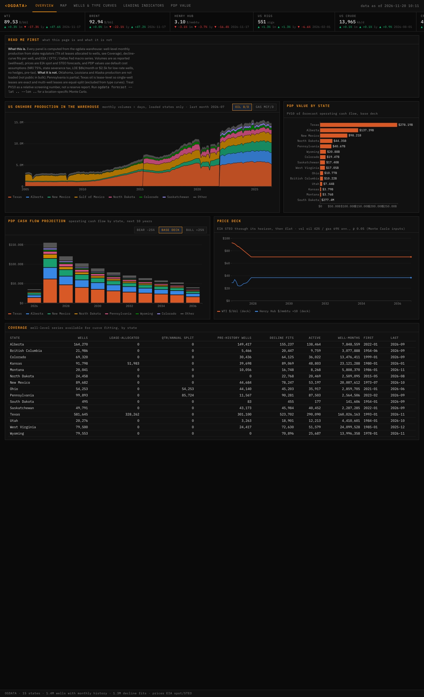
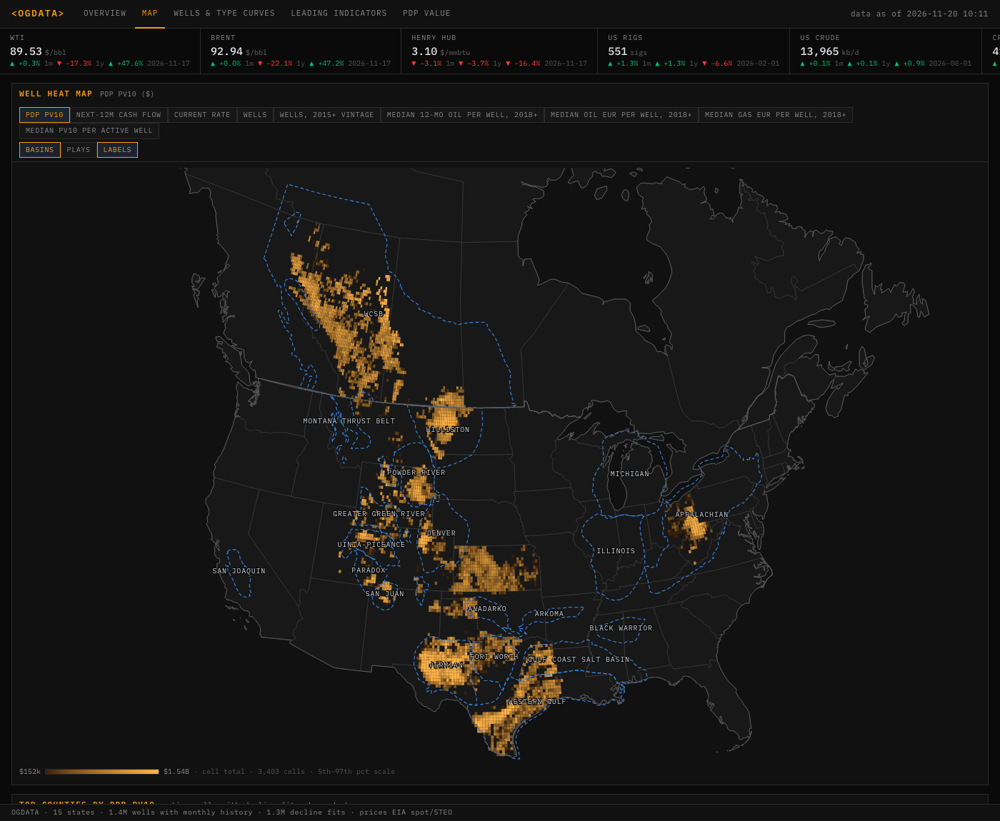
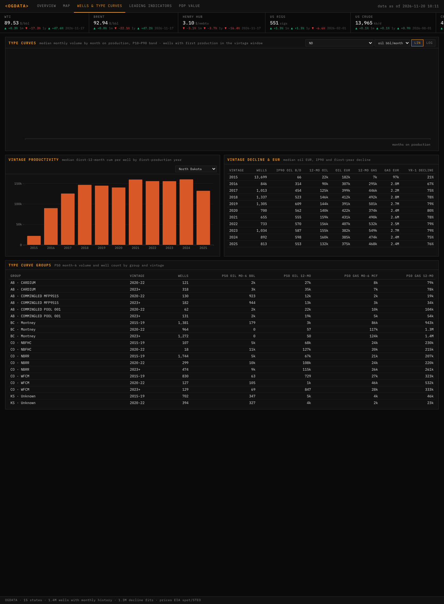
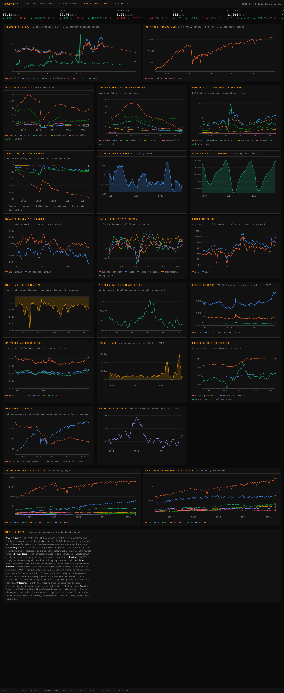
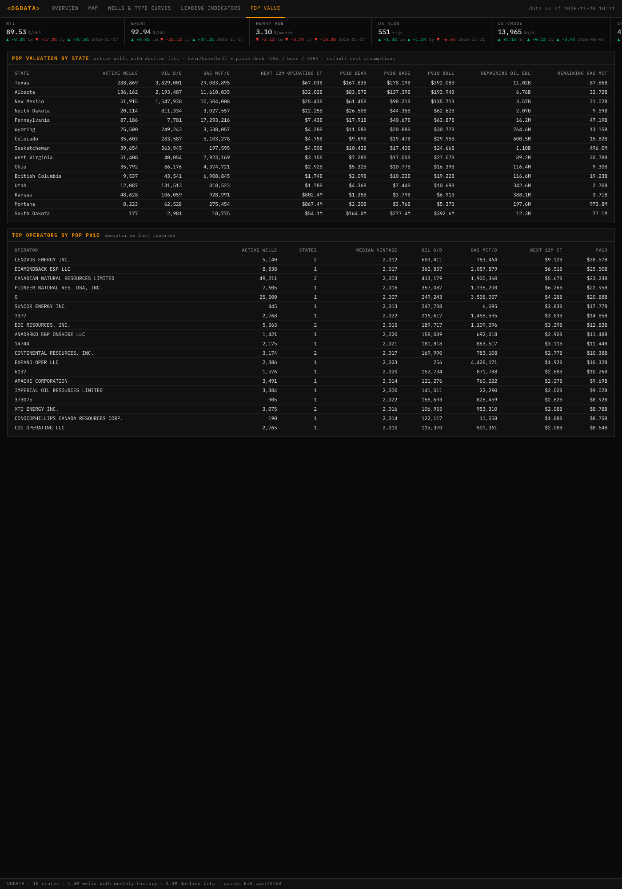
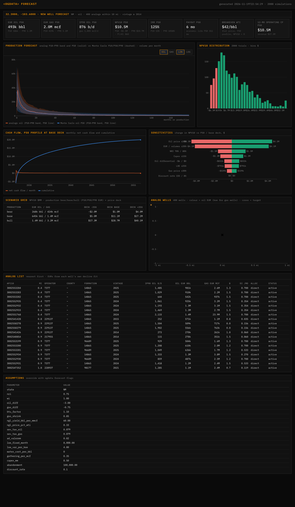

# OGDATA Monitor: dashboard walkthrough

`ogdata dashboard` writes `dashboards/og_monitor.html`, a single self-contained page (data embedded as JSON,
D3 and TopoJSON loaded from cdnjs, no server). It is rebuilt at the end of every `scripts/update.sh` run and
published as a private Claude artifact for the owner. This document walks through every panel, says exactly
which table and source each number comes from, and ends with the full source code of the dashboard.

Data flow in one line:

```
regulators / EIA / FRED / CFTC / Dallas Fed / Alberta  ──ogdata update──▶  production_monthly, wells, macro_series (parquet + DuckDB views)
   ──ogdata analytics──▶  well_monthly → well_decline → type_curves, well_value, state_cashflow, price_deck
   ──ogdata dashboard──▶  dashboards/og_monitor.html
```

Table definitions are in `schema.md`; the fitting and valuation method is in `analytics.md`; every source URL
and quirk is in `sources.md`. Screenshots below are from 2026-11-20.

## Header and ticker (every tab)



* **Nav**: five hash-routed views (`#overview`, `#map`, `#wells`, `#indicators`, `#value`). The build timestamp
  at the right is when `ogdata dashboard` ran.
* **Ticker**: latest value, change vs the previous observation, vs one month earlier and vs one year earlier.

| Item | Series (`macro_series.series_id`) | Source |
|---|---|---|
| WTI, Brent, Henry Hub | `eia:PET.RWTC.D`, `eia:PET.RBRTE.D`, `eia:NG.RNGWHHD.D` | EIA bulk spot prices (daily) |
| US rigs | `eia:PET.E_ERTRR0_XR0_NUS_C.M` | EIA monthly rig count |
| US crude | `eia:PET.MCRFPUS2.M` | EIA monthly field production |
| Crude stocks, gas storage | `eia:PET.WCESTUS1.W`, `eia:NG.NW2_EPG0_SWO_R48_BCF.W` | EIA weekly |
| Permian DUCs / rigs | `eia:STEO.DUCSPM.M`, `eia:STEO.RIGSPM.M` | EIA STEO |
| HY OAS, CCC OAS, HY yield, UST 10y, broad dollar | `fred:BAMLH0A0HYM2`, `fred:BAMLH0A3HYC`, `fred:BAMLH0A0HYM2EY`, `fred:DGS10`, `fred:DTWEXBGS` | FRED (needs `FRED_API_KEY`) |
| WCS, WCS−WTI, AB gas ref | `ab:WCS`, `ab:WCS_WTI_DIFF`, `ab:GASREF` | Alberta Economic Dashboard API (`camacro`) |
| WTI / NG managed-money net | CFTC `067651` / `023651` long − short | CFTC disaggregated COT |

Code: `dashboard.ticker()`; `_latest()` picks the last non-null observation and the values nearest 1 month and 1 year before it.

## Overview tab

* **Read me first**: static text describing what the page is (a screening monitor from public data) and is not
  (a reserve report). Keep it honest when adding panels.
* **US onshore production in the warehouse** (`state_production()`): monthly oil b/d and gas mcf/d by
  state/province summed from `production_monthly` where `period_months = 1`, from 2005, cut off four months
  before today so partially reported months do not show as a cliff. This is the regulator data itself, not
  EIA, so Texas is lease volumes, Ohio/PA-conventional are absent (quarterly/annual), and Alberta/Saskatchewan
  start in 2022. The per-state last full month is in the tooltip.
* **PDP value by state** (`tables()['states']`): sum of `well_value.pv10_usd` by state, base price deck. Only
  wells that are active and have a usable decline fit are valued.
* **PDP cash flow projection** (`cashflow()`): yearly sums of `state_cashflow.operating_cf_usd` for the next
  ten years, stacked by state, switchable between bear (deck −25 %), base and bull (+25 %) decks.
* **Price deck** (`price_deck` table): the WTI and Henry Hub path used by every PV on the page: EIA STEO
  monthly forecast where it exists, then flat; volatility and correlation estimated from ten years of monthly
  spot returns (`analytics/prices.py`).
* **Coverage** (`coverage()`): per state, wells and well-months in `well_monthly`, first/last month, how many
  wells are lease-allocated (TX/KS equal splits), quarterly/annual splits (OH, PA conventional), pre-history
  (`history_truncated`), fitted, active.

## Map tab



* **Well heat map** (`hex_cells()`): wells from `well_decline` joined to `well_locations` (best lat/lon per
  `api10` across sources, regulator preferred over FracFocus) and `well_value`, bucketed into 0.2° cells, cells
  with fewer than three wells dropped. Metric buttons:

| Metric | Definition | Aggregation |
|---|---|---|
| PDP PV10 | `well_value.pv10_usd` | cell sum |
| Next-12m cash flow | `well_value.cf_next12_usd` | cell sum |
| Current rate | `oil_rate_bpd + gas_rate_mcfd / 6` from the last three producing months | cell sum |
| Wells / wells 2015+ | counts from `well_decline` | cell sum |
| Median 12-mo oil per well, 2018+ | `oil_cum12` of oil wells, vintage ≥ 2018, direct-reported only | cell median |
| Median oil / gas EUR per well, 2018+ | `oil_eur` / `gas_eur` from each well's own Arps fit | cell median |
| Median PV10 per active well | `pv10_usd` | cell median |

  Colour is a log (for sums) or linear (for medians) ramp clipped at the 5th–97th percentile of the visible cells.
  Hover shows county, every metric and the active-well count.
* **Base map**: lower-48 states (us-atlas 10m) and Canadian provinces (Natural Earth 50m) on one Albers projection.
* **Layers**: *basins* = EIA sedimentary basins plus the Western Canada Sedimentary Basin (AGS); *plays* = EIA
  tight-oil/shale-gas plays, BC unconventional play trends, Alberta shale units (AGS); *labels* toggles the names.
  Built by `scripts/build_basins_asset.py`; provenance in `sources.md` "Map layers".
* **Top counties by PDP PV10** (`tables()['counties']`): `well_value` grouped by state and county.

## Wells & type curves tab



* **Type curves** (`type_curves` table): for a group (state, or state + formation, the three largest formations
  per state) and vintage bucket, the P10/P50/P90 monthly volume by month on production, from the wells' actual
  history (`well_monthly` normalised to first production). Only wells with directly reported monthly data and
  a complete early history are used (`alloc IN ('direct','single') AND NOT history_truncated`); vintage buckets
  2015–19, 2020–22, 2023+. Oil/gas and linear/log toggles. Built with t-digest quantiles state by state.
* **Vintage productivity** (`vintage_table()`): median first-12-month cum per well by first-production year,
  oil or gas depending on which dominates the state. Same exclusions as the type curves.
* **Vintage decline & EUR**: the same cohorts with median IP90, 12-month cum, EUR (fitted wells only) and
  first-year effective decline from the Arps fit.
* **Type curve groups**: P50 month-6 volume, 12-month P50 cum and well count for every group/vintage shown.

## Leading indicators tab



All series are `macro_series` rows; `indicators()` lists the exact ids. Panels, left to right, top to bottom:

| Panel | Series | Why it is here |
|---|---|---|
| Crude & gas spot vs STEO | EIA spot weekly means; STEO `WTIPUUS`, `NGHHUUS` dashed | the deck behind every PV |
| US crude production | `PET.MCRFPUS2.M` actual; STEO `COPRPUS` forecast | supply trend |
| Rigs / DUCs by basin | STEO `RIGS*`, `DUCS*` per basin | activity leads supply 3–9 months |
| New-well oil production per rig | STEO `CONWR*` | productivity / rock quality |
| Legacy production change | STEO `COEOP*` | base decline operators must out-drill |
| Crude stocks ex-SPR, working gas | EIA weekly | near-term price skew |
| Managed money net length | CFTC long − short | positioning |
| Dallas Fed Energy Survey | `dfed:all_firms:*` | sentiment turns before capex |
| Canadian crude, WCS−WTI, Alberta gas reference | `ab:*` (Alberta Economic Dashboard) | heavy-oil netbacks, Crown gas royalty reference |
| Credit spreads, HY yield vs Treasuries | FRED ICE BofA OAS/yields, `DGS2`, `DGS10` | refinancing risk for levered producers (3 years of history only on FRED) |
| Brent − WTI | FRED `DCOILBRENTEU` − `DCOILWTICO` | export pull / domestic balance |
| Oilfield cost inflation | FRED PPIs `PCU213111213111`, `PCU213112213112`, `PCU211211` | capex and LOE pressure |
| Upstream activity | FRED `CES1021100001`, `IPG211S` | employment and output |
| Broad dollar | FRED `DTWEXBGS` | inverse to crude in risk-off |
| Crude / gas by state | EIA `PET.MCRFP*`, `NG.N9010*` | state trends independent of our regulator data |

The "What to watch" note at the bottom is the one-paragraph reading guide for these.

## PDP value tab



* **PDP valuation by state**: active wells, oil b/d, gas mcf/d, PV10 at bear/base/bull decks, next-12-month
  cash flow and remaining reserves from `well_value`.
* **Top operators by PDP PV10**: `well_value` grouped by the operator last reported for the well.

How a `well_value` row is made (`analytics/valuation.py`): take the well's Arps fit from `well_decline`,
re-anchor on its last three producing months, forecast 240 months (shifted by the months since the well last
reported), run `economics.cashflows()` with the state's default assumptions (severance or Crown-royalty
placeholder, NRI 75 %, LOE, differentials; low-rate wells get stripper costs), stop at the economic limit,
discount at 10 %. It is a screening number under uniform assumptions, not a reserve report.

## The forecast report (same code family)



`ogdata forecast --lat .. --lon .. --html out.html` (or `--api10` for an existing well) renders the same chart
library into a one-well page: analog band from the nearest wells' real history, Monte Carlo P10/P50/P90, NPV
distribution, P50 cash flow, tornado, 3×3 scenario grid, analog map and list, assumptions. Code:
`analytics/forecast.py` (numbers) and `analytics/report.py` (page).

## Caveats to keep in view

* Texas oil is lease-level; `lease_alloc` wells are equal splits and are kept out of curves and analogs.
* Ohio and PA-conventional wells are quarterly/annual totals spread over months (`q_split`/`a_split`); they
  are valued and mapped but not used for curves.
* Alberta/Saskatchewan well history starts 2022-01 (public Petrinex); older wells are `history_truncated`.
* FRED's ICE BofA spread series only carry ~3 years of history.
* State production on the Overview is regulator data and lags EIA by 2–4 months; the Indicators tab shows EIA's own state series for comparison.
* The dashboard follows the owner's TCRED design tokens (`theme.css`): do not restyle it.

<!-- CODE APPENDIX: generated by scripts/build_dashboard_doc.py; do not edit below -->

## Appendix: dashboard source code

Generated from the repository; the map assets (`states-10m.json`, `na-provinces.json`, `basins.json`) are data files and are not reproduced.

### `src/ogdata/analytics/dashboard.py`

Builds the JSON payload (ticker, indicators, state production, heat-map cells, type curves, vintages, cash flow, tables, coverage) from the DuckDB views and writes the self-contained HTML.

```python
"""Build the self-contained HTML monitor (dashboards/og_monitor.html).

All numbers are pre-aggregated here with DuckDB and embedded as JSON; the page renders them with
D3 (loaded from cdnjs). Styling follows the TCRED / situation-monitor terminal design system.
"""
from __future__ import annotations

import json
import logging
import math
from pathlib import Path

import duckdb
import numpy as np
import pandas as pd

from ..paths import ROOT
from .forecast import analytics_connection

log = logging.getLogger("ogdata.analytics.dashboard")
ASSETS = Path(__file__).parent / "assets"
CELL = 0.2  # degrees
BASINS = {"PM": "Permian", "BK": "Bakken", "EF": "Eagle Ford", "AP": "Appalachia", "HA": "Haynesville", "R48": "Rest of L48"}
STATES = {"TX": "Texas", "NM": "New Mexico", "ND": "North Dakota", "CO": "Colorado", "WY": "Wyoming", "UT": "Utah", "MT": "Montana", "KS": "Kansas",
          "WV": "West Virginia", "PA": "Pennsylvania", "OH": "Ohio", "GOM": "Gulf of Mexico", "OK": "Oklahoma", "LA": "Louisiana", "CA": "California"}


def _clean(o):
    if isinstance(o, dict):
        return {k: _clean(v) for k, v in o.items()}
    if isinstance(o, (list, tuple, np.ndarray)):
        return [_clean(v) for v in o]
    if isinstance(o, (np.floating, float)):
        return None if not math.isfinite(o) else round(float(o), 6)
    if isinstance(o, (np.integer,)):
        return int(o)
    if isinstance(o, (pd.Timestamp,)):
        return o.strftime("%Y-%m-%d")
    if o is pd.NaT:
        return None
    return o


def _series(con, sid: str, since: str | None = None, weekly: bool = False) -> dict:
    where = f"AND period >= '{since}'" if since else ""
    if weekly:
        df = con.execute(f"SELECT date_trunc('week', period) d, avg(value) v FROM macro_series WHERE series_id = ? AND value IS NOT NULL {where} GROUP BY 1 ORDER BY 1", [sid]).df()
    else:
        df = con.execute(f"SELECT period d, value v FROM macro_series WHERE series_id = ? AND value IS NOT NULL {where} ORDER BY 1", [sid]).df()
    return {"d": [x.strftime("%Y-%m-%d") for x in df.d], "v": [None if pd.isna(v) else float(v) for v in df.v]}


def _latest(con, sid: str):
    df = con.execute("SELECT period, value FROM macro_series WHERE series_id = ? AND value IS NOT NULL ORDER BY period", [sid]).df()
    if df.empty:
        return None
    df = df.set_index("period").value
    last = df.index[-1]
    def at(delta):
        idx = df.index[df.index <= last - delta]
        return float(df[idx[-1]]) if len(idx) else None
    v = float(df.iloc[-1])
    return {"value": v, "asof": last.strftime("%Y-%m-%d"), "prev": at(pd.Timedelta(days=1)), "m1": at(pd.DateOffset(months=1)), "y1": at(pd.DateOffset(years=1))}


def ticker(con) -> list[dict]:
    items = []
    for label, sid, unit, fmt in (("WTI", "eia:PET.RWTC.D", "$/bbl", "2"), ("BRENT", "eia:PET.RBRTE.D", "$/bbl", "2"), ("HENRY HUB", "eia:NG.RNGWHHD.D", "$/mmbtu", "2"),
                                  ("US RIGS", "eia:PET.E_ERTRR0_XR0_NUS_C.M", "rigs", "0"), ("US CRUDE", "eia:PET.MCRFPUS2.M", "kb/d", "0"),
                                  ("CRUDE STOCKS", "eia:PET.WCESTUS1.W", "kbbl", "0"), ("GAS STORAGE", "eia:NG.NW2_EPG0_SWO_R48_BCF.W", "bcf", "0"),
                                  ("PERMIAN DUCs", "eia:STEO.DUCSPM.M", "wells", "0"), ("PERMIAN RIGS", "eia:STEO.RIGSPM.M", "rigs", "0"),
                                  ("HY OAS", "fred:BAMLH0A0HYM2", "%", "2"), ("CCC OAS", "fred:BAMLH0A3HYC", "%", "2"), ("HY YIELD", "fred:BAMLH0A0HYM2EY", "%", "2"),
                                  ("UST 10Y", "fred:DGS10", "%", "2"), ("DXY BROAD", "fred:DTWEXBGS", "idx", "1"),
                                  ("WCS", "ab:WCS", "$/bbl", "2"), ("WCS-WTI", "ab:WCS_WTI_DIFF", "$/bbl", "2"), ("AB GAS REF", "ab:GASREF", "C$/GJ", "2")):
        l = _latest(con, sid)
        if l:
            items.append({"label": label, "unit": unit, "fmt": fmt, **l})
    # CFTC managed money net length
    for label, code in (("WTI MM NET", "067651"), ("NG MM NET", "023651")):
        df = con.execute(f"""
            SELECT l.period, l.value - s.value AS v FROM macro_series l JOIN macro_series s USING (period)
            WHERE l.series_id = 'cftc:{code}:M_Money_Positions_Long_All' AND s.series_id = 'cftc:{code}:M_Money_Positions_Short_All' ORDER BY 1""").df()
        if not df.empty:
            s = df.set_index("period").v
            last = s.index[-1]
            m1 = s[s.index <= last - pd.DateOffset(months=1)]
            y1 = s[s.index <= last - pd.DateOffset(years=1)]
            items.append({"label": label, "unit": "contracts", "fmt": "0", "value": float(s.iloc[-1]), "asof": last.strftime("%Y-%m-%d"),
                          "prev": float(s.iloc[-2]) if len(s) > 1 else None, "m1": float(m1.iloc[-1]) if len(m1) else None, "y1": float(y1.iloc[-1]) if len(y1) else None})
    return items


def indicators(con) -> dict:
    since3 = (pd.Timestamp.today() - pd.DateOffset(years=3)).strftime("%Y-%m-%d")
    since10 = (pd.Timestamp.today() - pd.DateOffset(years=10)).strftime("%Y-%m-%d")
    out = {
        "spot": {"wti": _series(con, "eia:PET.RWTC.D", since3, weekly=True), "brent": _series(con, "eia:PET.RBRTE.D", since3, weekly=True), "hh": _series(con, "eia:NG.RNGWHHD.D", since3, weekly=True)},
        "steo": {"wti": _series(con, "eia:STEO.WTIPUUS.M", since3), "hh": _series(con, "eia:STEO.NGHHUUS.M", since3),
                 "us_crude": _series(con, "eia:STEO.COPRPUS.M", since10), "us_gas": _series(con, "eia:STEO.NGPRPUS.M", since10)},
        "us_crude_actual": _series(con, "eia:PET.MCRFPUS2.M", since10),
        "rigs": {name: _series(con, f"eia:STEO.RIGS{code}.M", since10) for code, name in BASINS.items()},
        "ducs": {name: _series(con, f"eia:STEO.DUCS{code}.M", since10) for code, name in BASINS.items()},
        "newwell_per_rig_oil": {name: _series(con, f"eia:STEO.CONWR{code}.M", since10) for code, name in BASINS.items()},
        "legacy_decline_oil": {name: _series(con, f"eia:STEO.COEOP{code}.M", since10) for code, name in BASINS.items()},
        "stocks": {"crude_ex_spr": _series(con, "eia:PET.WCESTUS1.W", since3), "gas_storage": _series(con, "eia:NG.NW2_EPG0_SWO_R48_BCF.W", since3)},
        "dallas_fed": {k: _series(con, f"dfed:all_firms:{c}") for k, c in (("business_activity", "qbac"), ("capex", "qcexp"), ("company_outlook", "qolk"), ("uncertainty", "quncr"), ("employment", "qemp"))},
        "cftc": {},
        "state_gas_withdrawals": {st: _series(con, f"eia:NG.N9010{st}2.M", since10) for st in ("TX", "PA", "LA", "WV", "OH", "NM", "OK", "CO", "ND")},
        "state_crude_prod": {},
        # FRED (needs FRED_API_KEY; ICE BofA history on FRED is limited to ~3 years)
        "credit": {"HY OAS": _series(con, "fred:BAMLH0A0HYM2", since3), "CCC & lower OAS": _series(con, "fred:BAMLH0A3HYC", since3), "IG OAS": _series(con, "fred:BAMLC0A0CM", since3)},
        "rates": {"HY effective yield": _series(con, "fred:BAMLH0A0HYM2EY", since3), "UST 10y": _series(con, "fred:DGS10", since3), "UST 2y": _series(con, "fred:DGS2", since3)},
        "cost_ppi": {"Drilling O&G wells": _series(con, "fred:PCU213111213111", since10), "Support activities": _series(con, "fred:PCU213112213112", since10), "O&G extraction (realised price)": _series(con, "fred:PCU211211", since10)},
        "sector": {"O&G extraction employment (k)": _series(con, "fred:CES1021100001", since10), "O&G extraction IP (2017=100)": _series(con, "fred:IPG211S", since10)},
        "dollar": _series(con, "fred:DTWEXBGS", since3, weekly=True),
        "brent_wti": {},
        "canada": {"WCS": _series(con, "ab:WCS", since10), "WTI": _series(con, "ab:WTI", since10), "WCS − WTI": _series(con, "ab:WCS_WTI_DIFF", since10), "AB gas reference C$/GJ": _series(con, "ab:GASREF", since10)},
    }
    bw = con.execute(f"""
        SELECT date_trunc('week', b.period) d, avg(b.value - w.value) v FROM macro_series b JOIN macro_series w USING (period)
        WHERE b.series_id = 'fred:DCOILBRENTEU' AND w.series_id = 'fred:DCOILWTICO' AND b.value IS NOT NULL AND w.value IS NOT NULL AND b.period >= '{since3}' GROUP BY 1 ORDER BY 1""").df()
    out["brent_wti"] = {"d": [x.strftime("%Y-%m-%d") for x in bw.d], "v": [float(v) for v in bw.v]}
    for label, code in (("WTI (NYMEX)", "067651"), ("Natural gas (NYMEX)", "023651")):
        df = con.execute(f"""
            SELECT l.period d, l.value - s.value AS v FROM macro_series l JOIN macro_series s USING (period)
            WHERE l.series_id = 'cftc:{code}:M_Money_Positions_Long_All' AND s.series_id = 'cftc:{code}:M_Money_Positions_Short_All' AND l.period >= '{since3}' ORDER BY 1""").df()
        out["cftc"][label] = {"d": [x.strftime("%Y-%m-%d") for x in df.d], "v": [float(v) for v in df.v]}
    for st, code in (("TX", "TX1"), ("NM", "NM1"), ("ND", "ND1"), ("CO", "CO1"), ("OK", "OK1"), ("WY", "WY1"), ("GOM", "FX1"), ("LA", "LA1"), ("AK", "AK1"), ("CA", "CA1"), ("UT", "UT1")):
        s = _series(con, f"eia:PET.MCRFP{code}.M", since10)
        if s["d"]:
            out["state_crude_prod"][st] = s
    return out


def state_production(con) -> dict:
    df = con.execute("""
        SELECT state, period, sum(oil_bbl) oil, sum(gas_mcf) gas
        FROM production_monthly WHERE coalesce(period_months,1) = 1 AND period >= '2005-01-01' AND period <= current_date - INTERVAL 4 MONTH
        GROUP BY 1, 2 ORDER BY 2
    """).df()
    months = sorted(df.period.unique())
    piv_o = df.pivot(index="period", columns="state", values="oil").reindex(months)
    piv_g = df.pivot(index="period", columns="state", values="gas").reindex(months)
    days = pd.Series(pd.DatetimeIndex(months).days_in_month, index=months)
    out = {"months": [m.strftime("%Y-%m") for m in months], "oil_bpd": {}, "gas_mcfd": {}}
    for st in piv_o.columns:
        out["oil_bpd"][st] = [None if pd.isna(v) else round(float(v), 0) for v in (piv_o[st] / days)]
        out["gas_mcfd"][st] = [None if pd.isna(v) else round(float(v), 0) for v in (piv_g[st] / days)]
    out["last_full_month"] = {st: con.execute("SELECT max(period) FROM production_monthly WHERE state = ?", [st]).fetchone()[0].strftime("%Y-%m") for st in piv_o.columns}
    return out


def hex_cells(con) -> list[dict]:
    df = con.execute(f"""
        WITH w AS (
            SELECT d.api10, d.state, d.county, d.vintage, d.status, d.primary_product, d.alloc, d.history_truncated,
                   d.oil_cum12, d.gas_cum12, d.oil_eur, d.gas_eur, d.boe_eur, d.oil_ip90_pd, d.gas_ip90_pd,
                   v.pv10_usd, v.cf_next12_usd, v.oil_remaining_bbl, v.gas_remaining_mcf, v.oil_rate_bpd, v.gas_rate_mcfd,
                   floor(l.lat / {CELL}) * {CELL} AS clat, floor(l.lon / {CELL}) * {CELL} AS clon
            FROM well_decline d JOIN well_locations l USING (api10) LEFT JOIN well_value v USING (api10)
            WHERE l.lat BETWEEN 24 AND 62 AND l.lon BETWEEN -141 AND -52
        )
        SELECT clat, clon, mode(state) st, mode(county) county, count(*) n,
               count(*) FILTER (WHERE vintage >= 2015) n15, count(*) FILTER (WHERE status = 'active') n_active,
               count(*) FILTER (WHERE vintage >= 2018 AND alloc IN ('direct', 'single') AND NOT history_truncated) n18,
               quantile_cont(oil_cum12, 0.5) FILTER (WHERE vintage >= 2018 AND alloc IN ('direct', 'single') AND NOT history_truncated AND primary_product = 'oil') cum12_oil,
               quantile_cont(gas_cum12, 0.5) FILTER (WHERE vintage >= 2018 AND alloc IN ('direct', 'single') AND NOT history_truncated AND primary_product = 'gas') cum12_gas,
               quantile_cont(oil_eur, 0.5) FILTER (WHERE vintage >= 2018 AND alloc IN ('direct', 'single') AND NOT history_truncated AND primary_product = 'oil') eur_oil,
               quantile_cont(gas_eur, 0.5) FILTER (WHERE vintage >= 2018 AND alloc IN ('direct', 'single') AND NOT history_truncated AND primary_product = 'gas') eur_gas,
               quantile_cont(boe_eur, 0.5) FILTER (WHERE vintage >= 2018 AND alloc IN ('direct', 'single') AND NOT history_truncated) eur_boe,
               sum(pv10_usd) pv10, sum(cf_next12_usd) cf12, sum(oil_remaining_bbl + gas_remaining_mcf / 6) rem_boe,
               sum(oil_rate_bpd + gas_rate_mcfd / 6) boed, sum(oil_rate_bpd) bopd, sum(gas_rate_mcfd) mcfd,
               quantile_cont(pv10_usd, 0.5) FILTER (WHERE status = 'active') pv10_med
        FROM w GROUP BY 1, 2 HAVING count(*) >= 3
    """).df()
    cells = []
    for r in df.itertuples(index=False):
        cells.append({"lat": round(r.clat, 3), "lon": round(r.clon, 3), "st": r.st, "county": r.county, "n": int(r.n), "n15": int(r.n15), "n_active": int(r.n_active), "n18": int(r.n18),
                      "cum12_oil": r.cum12_oil, "cum12_gas": r.cum12_gas, "eur_oil": r.eur_oil, "eur_gas": r.eur_gas, "eur_boe": r.eur_boe,
                      "pv10": r.pv10, "cf12": r.cf12, "rem_boe": r.rem_boe, "boed": r.boed, "bopd": r.bopd, "mcfd": r.mcfd, "pv10_med": r.pv10_med})
    return _clean(cells)


def type_curves(con) -> dict:
    out = {}
    groups = con.execute("""
        SELECT group_type, state, key, vintage, max(n_wells) nw FROM type_curves
        WHERE t = 6 AND vintage IN ('2015-19', '2020-22', '2023+') AND (group_type = 'state' OR group_type = 'state_formation')
        GROUP BY ALL HAVING max(n_wells) >= 30 ORDER BY state, group_type, nw DESC
    """).df()
    keep = []
    for (st, gt), g in groups.groupby(["state", "group_type"]):
        if gt == "state":
            keep += [(st, gt, k) for k in g.key.unique()]
        else:
            top = g.groupby("key").nw.max().sort_values(ascending=False).head(3).index
            keep += [(st, gt, k) for k in top]
    for st, gt, key in keep:
        rows = con.execute("""
            SELECT vintage, t, n_wells, oil_p10, oil_p50, oil_p90, oil_mean, gas_p10, gas_p50, gas_p90, gas_mean FROM type_curves
            WHERE state = ? AND group_type = ? AND coalesce(key, '') = coalesce(?::VARCHAR, '') AND t < 72 AND vintage IN ('2015-19', '2020-22', '2023+') ORDER BY vintage, t
        """, [st, gt, key]).df()
        label = st if gt == "state" else f"{st} · {key}"
        out[label] = {"state": st, "group_type": gt, "key": key, "vintages": {}}
        for v, gg in rows.groupby("vintage"):
            out[label]["vintages"][v] = {c: gg[c].tolist() for c in ("t", "n_wells", "oil_p10", "oil_p50", "oil_p90", "gas_p10", "gas_p50", "gas_p90")}
    return _clean(out)


def vintage_table(con) -> list[dict]:
    df = con.execute("""
        SELECT state, vintage, count(*) n, count(*) FILTER (WHERE primary_product='oil') n_oil,
               quantile_cont(oil_cum12, 0.5) FILTER (WHERE primary_product='oil') cum12_oil_med,
               quantile_cont(gas_cum12, 0.5) FILTER (WHERE primary_product='gas') cum12_gas_med,
               quantile_cont(oil_eur, 0.5) FILTER (WHERE primary_product='oil' AND oil_fit_ok) eur_oil_med,
               quantile_cont(gas_eur, 0.5) FILTER (WHERE primary_product='gas' AND gas_fit_ok) eur_gas_med,
               quantile_cont(oil_ip90_pd, 0.5) FILTER (WHERE primary_product='oil') ip90_oil_med,
               quantile_cont(oil_d1_eff, 0.5) FILTER (WHERE primary_product='oil' AND oil_fit_ok) d1_oil_med
        FROM well_decline WHERE vintage BETWEEN 2008 AND year(current_date) - 1 AND alloc IN ('direct', 'single') AND NOT history_truncated
        GROUP BY 1, 2 HAVING count(*) >= 20 ORDER BY 1, 2
    """).df()
    return _clean(df.to_dict(orient="records"))


def cashflow(con) -> dict:
    df = con.execute("""
        SELECT state, deck, year(month) yr, sum(operating_cf_usd) cf FROM state_cashflow GROUP BY ALL ORDER BY 3
    """).df()
    deck = con.execute("SELECT month, wti, hh, vol_oil, vol_gas, rho FROM price_deck ORDER BY month").df()
    out = {"years": sorted(df.yr.unique().tolist()), "decks": {}, "price_deck": {"months": [m.strftime("%Y-%m") for m in deck.month[:120]], "wti": deck.wti[:120].tolist(), "hh": deck.hh[:120].tolist(),
           "vol_oil": float(deck.vol_oil[0]), "vol_gas": float(deck.vol_gas[0]), "rho": float(deck.rho[0])}}
    for d, g in df.groupby("deck"):
        piv = g.pivot(index="yr", columns="state", values="cf").reindex(out["years"]).fillna(0)
        out["decks"][d] = {st: piv[st].tolist() for st in piv.columns}
    return _clean(out)


def tables(con) -> dict:
    counties = con.execute("""
        SELECT state, county, count(*) wells, sum(pv10_usd) pv10, sum(cf_next12_usd) cf12, sum(oil_remaining_bbl) rem_oil, sum(gas_remaining_mcf) rem_gas,
               sum(oil_rate_bpd) bopd, sum(gas_rate_mcfd) mcfd
        FROM well_value WHERE county IS NOT NULL GROUP BY 1, 2 ORDER BY pv10 DESC LIMIT 40
    """).df()
    ops = con.execute("""
        SELECT operator, count(*) wells, count(DISTINCT state) states, sum(pv10_usd) pv10, sum(cf_next12_usd) cf12, sum(oil_rate_bpd) bopd, sum(gas_rate_mcfd) mcfd,
               quantile_cont(vintage, 0.5) med_vintage
        FROM well_value WHERE operator IS NOT NULL GROUP BY 1 ORDER BY pv10 DESC LIMIT 40
    """).df()
    totals = con.execute("""
        SELECT state, count(*) wells, sum(pv10_usd) pv10, sum(pv10_bear_usd) pv10_bear, sum(pv10_bull_usd) pv10_bull, sum(cf_next12_usd) cf12,
               sum(oil_rate_bpd) bopd, sum(gas_rate_mcfd) mcfd, sum(oil_remaining_bbl) rem_oil, sum(gas_remaining_mcf) rem_gas
        FROM well_value GROUP BY 1 ORDER BY pv10 DESC
    """).df()
    return _clean({"counties": counties.to_dict(orient="records"), "operators": ops.to_dict(orient="records"), "states": totals.to_dict(orient="records")})


def coverage(con) -> list[dict]:
    df = con.execute("""
        SELECT state, count(DISTINCT api10) wells, count(*) AS well_months, min(period) AS first, max(period) AS last,
               count(DISTINCT api10) FILTER (WHERE alloc = 'lease_alloc') lease_alloc_wells,
               count(DISTINCT api10) FILTER (WHERE alloc IN ('q_split', 'a_split')) split_wells
        FROM well_monthly GROUP BY 1 ORDER BY 1
    """).df()
    fits = con.execute("SELECT state, count(*) n, count(*) FILTER (WHERE oil_fit_ok OR gas_fit_ok) fitted, count(*) FILTER (WHERE status='active') active, count(*) FILTER (WHERE history_truncated) truncated FROM well_decline GROUP BY 1").df()
    df = df.merge(fits, on="state", how="left")
    return _clean(df.to_dict(orient="records"))


def build(out: str | None = None) -> Path:
    con = analytics_connection()
    data = {
        "generated": pd.Timestamp.now().strftime("%Y-%m-%d %H:%M"),
        "ticker": ticker(con), "indicators": indicators(con), "state_production": state_production(con), "hex": hex_cells(con),
        "type_curves": type_curves(con), "vintages": vintage_table(con), "cashflow": cashflow(con), "tables": tables(con), "coverage": coverage(con),
    }
    con.close()
    tpl = (ASSETS / "dashboard_template.html").read_text()
    topo = (ASSETS / "states-10m.json").read_text()
    na_topo = (ASSETS / "na-provinces.json").read_text()
    basins_topo = (ASSETS / "basins.json").read_text()
    html = tpl.replace("/*__DATA__*/", "const DATA = " + json.dumps(_clean(data), separators=(",", ":")) + ";\nconst US_TOPO = " + topo + ";\nconst NA_TOPO = " + na_topo + ";\nconst BASINS_TOPO = " + basins_topo + ";")
    html = html.replace("/*__THEME_CSS__*/", (ASSETS / "theme.css").read_text()).replace("/*__CHARTS_JS__*/", (ASSETS / "charts.js").read_text())
    dest = Path(out) if out else ROOT / "dashboards" / "og_monitor.html"
    dest.parent.mkdir(parents=True, exist_ok=True)
    dest.write_text(html)
    log.info("dashboard %s (%.1f MB)", dest, dest.stat().st_size / 1e6)
    return dest
```

### `src/ogdata/analytics/assets/dashboard_template.html`

Page markup and all view-specific JavaScript (hash-routed tabs, map projection and layers, type-curve controls, tables). Placeholders /*__DATA__*/, /*__THEME_CSS__*/ and /*__CHARTS_JS__*/ are filled at build time.

```html
<title>OGDATA Monitor</title>
<meta name="claude:viewport-fit-sides" content="cover">
<link rel="stylesheet" href="https://fonts.googleapis.com/css2?family=IBM+Plex+Mono:wght@400;500;600&family=IBM+Plex+Sans:wght@400;500&display=swap">
<style>
/*__THEME_CSS__*/
</style>
<div class="topbar">
  <span class="topbar-title">&lt;OGDATA&gt;</span>
  <nav class="tabnav" id="nav">
    <button data-view="overview" class="active">Overview</button>
    <button data-view="map">Map</button>
    <button data-view="wells">Wells &amp; type curves</button>
    <button data-view="indicators">Leading indicators</button>
    <button data-view="value">PDP value</button>
  </nav>
  <span class="topbar-meta" id="meta"></span>
</div>
<div class="ticker" id="ticker"></div>
<div class="wrap">
  <section class="view" id="view-overview">
    <div class="grid">
      <div class="panel span12"><div class="hd"><h2>Read me first</h2><span class="sub">what this page is and what it is not</span></div>
        <div class="bd note" id="readme"></div></div>
      <div class="panel span8"><div class="hd"><h2>US onshore production in the warehouse</h2><span class="sub" id="prod-sub"></span>
          <div class="ctl seg" id="prod-seg"><button data-k="oil_bpd" class="on">Oil b/d</button><button data-k="gas_mcfd">Gas mcf/d</button></div></div>
        <div class="bd"><div class="chart" id="prod-chart"></div></div></div>
      <div class="panel span4"><div class="hd"><h2>PDP value by state</h2><span class="sub">PV10 of forecast operating cash flow, base deck</span></div>
        <div class="bd"><div class="chart" id="pv-state"></div></div></div>
      <div class="panel span6"><div class="hd"><h2>PDP cash flow projection</h2><span class="sub">operating cash flow by state, next 10 years</span>
          <div class="ctl seg" id="cf-seg"><button data-k="bear">Bear −25%</button><button data-k="base" class="on">Base deck</button><button data-k="bull">Bull +25%</button></div></div>
        <div class="bd"><div class="chart" id="cf-chart"></div></div></div>
      <div class="panel span6"><div class="hd"><h2>Price deck</h2><span class="sub" id="deck-sub"></span></div>
        <div class="bd"><div class="chart" id="deck-chart"></div></div></div>
      <div class="panel span12"><div class="hd"><h2>Coverage</h2><span class="sub">well-level series available for curve fitting, by state</span></div>
        <div class="bd" id="coverage"></div></div>
    </div>
  </section>
  <section class="view" id="view-map" hidden>
    <div class="grid">
      <div class="panel span12"><div class="hd"><h2>Well heat map</h2><span class="sub" id="map-sub">0.2° cells · hover for county detail</span>
          <div class="ctl"><div class="seg" id="map-seg"></div><div class="seg" id="layer-seg" title="map layers"><button data-l="basins" class="on">basins</button><button data-l="plays">plays</button><button data-l="labels" class="on">labels</button></div></div></div>
        <div class="bd"><div class="map" id="heatmap"></div><div class="ramp" id="ramp"></div></div></div>
      <div class="panel span12"><div class="hd"><h2>Top counties by PDP PV10</h2><span class="sub">active wells with decline fits, base deck</span></div>
        <div class="bd" id="counties"></div></div>
    </div>
  </section>
  <section class="view" id="view-wells" hidden>
    <div class="grid">
      <div class="panel span12"><div class="hd"><h2>Type curves</h2><span class="sub">median monthly volume by month on production, P10–P90 band · wells with first production in the vintage window</span>
          <div class="ctl"><select id="tc-group"></select><select id="tc-prod"><option value="oil">oil bbl/month</option><option value="gas">gas mcf/month</option></select>
            <div class="seg" id="tc-scale"><button data-k="lin" class="on">lin</button><button data-k="log">log</button></div></div></div>
        <div class="bd"><div class="chart" id="tc-chart"></div></div></div>
      <div class="panel span6"><div class="hd"><h2>Vintage productivity</h2><span class="sub">median first-12-month cum per well by first-production year</span>
          <div class="ctl"><select id="vt-state"></select></div></div>
        <div class="bd"><div class="chart" id="vt-chart"></div></div></div>
      <div class="panel span6"><div class="hd"><h2>Vintage decline &amp; EUR</h2><span class="sub">median oil EUR, IP90 and first-year decline</span></div>
        <div class="bd" id="vt-table"></div></div>
      <div class="panel span12"><div class="hd"><h2>Type curve groups</h2><span class="sub">P50 month-6 volume and well count by group and vintage</span></div>
        <div class="bd" id="tc-table"></div></div>
    </div>
  </section>
  <section class="view" id="view-indicators" hidden>
    <div class="grid" id="ind-grid"></div>
  </section>
  <section class="view" id="view-value" hidden>
    <div class="grid">
      <div class="panel span12"><div class="hd"><h2>PDP valuation by state</h2><span class="sub">active wells with decline fits · bear/base/bull = price deck −25% / base / +25% · default cost assumptions</span></div>
        <div class="bd" id="val-states"></div></div>
      <div class="panel span12"><div class="hd"><h2>Top operators by PDP PV10</h2><span class="sub">operator as last reported</span></div>
        <div class="bd" id="operators"></div></div>
    </div>
  </section>
</div>
<div class="statusbar"><span id="status"></span></div>
<script src="https://cdnjs.cloudflare.com/ajax/libs/d3/7.9.0/d3.min.js"></script>
<script src="https://cdnjs.cloudflare.com/ajax/libs/topojson/3.0.2/topojson.min.js"></script>
<script>
/*__DATA__*/
/*__CHARTS_JS__*/
const STATE_NAMES = {TX:'Texas',NM:'New Mexico',ND:'North Dakota',CO:'Colorado',WY:'Wyoming',UT:'Utah',MT:'Montana',KS:'Kansas',WV:'West Virginia',PA:'Pennsylvania',OH:'Ohio',GOM:'Gulf of Mexico',OK:'Oklahoma',LA:'Louisiana',CA:'California',AK:'Alaska',AB:'Alberta',SK:'Saskatchewan',BC:'British Columbia',MB:'Manitoba',SD:'South Dakota'};
const toPts = (s, parse = parseD) => s.d.map((d, i) => ({ d: parse(d), v: s.v[i] }));
const sum = a => a.reduce((x, y) => x + (y || 0), 0);
document.getElementById('meta').textContent = `data as of ${DATA.generated}`;
document.getElementById('status').textContent = `OGDATA · ${DATA.coverage.length} states · ${fmt.big(sum(DATA.coverage.map(c => c.wells)))} wells with monthly history · ${fmt.big(sum(DATA.coverage.map(c => c.fitted || 0)))} decline fits · prices EIA spot/STEO`;

/* ---- nav (hash routed) */
const views = ['overview', 'map', 'wells', 'indicators', 'value'];
function show(v) { if (!views.includes(v)) v = 'overview'; views.forEach(k => { document.getElementById('view-' + k).hidden = k !== v; });
  document.querySelectorAll('#nav button').forEach(b => b.classList.toggle('active', b.dataset.view === v)); if (location.hash !== '#' + v) history.replaceState(null, '', '#' + v); rendered[v] || (rendered[v] = true, RENDER[v]()); }
const rendered = {}; const RENDER = {};
document.getElementById('nav').addEventListener('click', e => { const b = e.target.closest('button'); if (b) show(b.dataset.view); });
window.addEventListener('hashchange', () => show(location.hash.slice(1)));

/* ---- ticker */
(function () { const t = d3.select('#ticker');
  DATA.ticker.forEach(k => { const d = k.fmt === '2' ? 2 : 0; const chg = (a, b) => (a == null || b == null) ? '' : `<span class="${a - b >= 0 ? 'pos' : 'neg'}">${a - b >= 0 ? '▲' : '▼'} ${fmt.pct((a / b - 1) * 100)}</span>`;
    t.append('div').attr('class', 'tick').html(`<div class="l">${k.label}</div><div class="v">${fmt.num(k.value, d)}<span class="u">${k.unit}</span></div><div class="c">${chg(k.value, k.prev)} <span class="dim">1m</span> ${chg(k.value, k.m1)} <span class="dim">1y</span> ${chg(k.value, k.y1)} <span class="dim">${k.asof}</span></div>`); }); })();

/* ---- overview */
RENDER.overview = () => {
  document.getElementById('readme').innerHTML = `<b>What this is.</b> Every panel is computed from the ogdata warehouse: well-level monthly production from state regulators (TX oil leases allocated to wells, see Coverage), decline-curve fits per well, and EIA / CFTC / Dallas Fed macro series. Volumes are as reported (wellhead), prices are EIA spot and STEO forecasts, and PDP values use default cost assumptions (NRI 75%, state severance tax, LOE $8k/month or $2.5k for low-rate wells, no hedges, pre-tax). <b>What it is not.</b> Oklahoma, Louisiana and Alaska production are not loaded (not public in bulk); Pennsylvania's monthly history is still back-filling; Texas oil is lease-level so single-well leases are exact and multi-well leases are equal-split (excluded from type curves); Ohio and PA-conventional wells are quarterly/annual totals spread over months; Alberta and Saskatchewan well history starts 2022 (public Petrinex) and Canadian economics use Crown-royalty placeholders. Treat
    PV10 as a relative screening number, not a reserve report. Run <code>ogdata forecast --lat .. --lon ..</code> for a location-specific Monte Carlo.`;
  const sp = DATA.state_production; const months = sp.months.map(parseM);
  function prodChart(key) { const totals = Object.entries(sp[key]).map(([st, v]) => [st, sum(v.slice(-12))]).sort((a, b) => b[1] - a[1]);
    const top = totals.slice(0, 7).map(t => t[0]); const other = totals.slice(7).map(t => t[0]);
    const series = top.map((st, i) => ({ label: STATE_NAMES[st] || st, color: SERIES[i], values: sp[key][st].map(v => v || 0) }));
    if (other.length) series.push({ label: 'Other', color: '#555', values: months.map((_, i) => sum(other.map(st => sp[key][st][i]))) });
    stackedArea(document.getElementById('prod-chart'), { x: months, series, height: 260, yFmt: fmt.big });
    document.getElementById('prod-sub').textContent = `monthly volumes ÷ days, loaded states only · last month ${sp.months.at(-1)}`; }
  prodChart('oil_bpd');
  document.getElementById('prod-seg').addEventListener('click', e => { const b = e.target.closest('button'); if (!b) return; document.querySelectorAll('#prod-seg button').forEach(x => x.classList.toggle('on', x === b)); prodChart(b.dataset.k); });
  const st = DATA.tables.states.filter(s => s.pv10 > 0);
  barChart(document.getElementById('pv-state'), { horizontal: true, ml: 110, items: st.map(s => ({ label: STATE_NAMES[s.state] || s.state, value: s.pv10 })), yFmt: fmt.usd });
  const cf = DATA.cashflow;
  function cfChart(deck) { const d = cf.decks[deck]; const order = Object.entries(d).map(([s, v]) => [s, sum(v)]).sort((a, b) => b[1] - a[1]); const top = order.slice(0, 7).map(o => o[0]), other = order.slice(7).map(o => o[0]);
    const series = top.map((s, i) => ({ label: STATE_NAMES[s] || s, color: SERIES[i], values: d[s] })); if (other.length) series.push({ label: 'Other', color: '#555', values: cf.years.map((_, i) => sum(other.map(s => d[s][i]))) });
    stackedArea(document.getElementById('cf-chart'), { x: cf.years.map(String), xType: 'band', series, height: 240, yFmt: fmt.usd }); }
  cfChart('base');
  document.getElementById('cf-seg').addEventListener('click', e => { const b = e.target.closest('button'); if (!b) return; document.querySelectorAll('#cf-seg button').forEach(x => x.classList.toggle('on', x === b)); cfChart(b.dataset.k); });
  const pdm = cf.price_deck.months.map(parseM);
  lineChart(document.getElementById('deck-chart'), { height: 240, yZero: true, series: [{ label: 'WTI $/bbl (deck)', color: SERIES[0], points: pdm.map((d, i) => ({ d, v: cf.price_deck.wti[i] })), thick: true },
    { label: 'Henry Hub $/mmbtu ×10 (deck)', color: SERIES[1], points: pdm.map((d, i) => ({ d, v: cf.price_deck.hh[i] * 10 })) }], yFmt: v => '$' + fmt.num(v, 0) });
  document.getElementById('deck-sub').textContent = `EIA STEO through its horizon, then flat · vol oil ${(cf.price_deck.vol_oil * 100).toFixed(0)}% / gas ${(cf.price_deck.vol_gas * 100).toFixed(0)}% ann., ρ ${cf.price_deck.rho.toFixed(2)} (Monte Carlo inputs)`;
  table(document.getElementById('coverage'), { rows: DATA.coverage, cols: [{ key: 'state', label: 'state', fmt: v => STATE_NAMES[v] || v }, { key: 'wells', label: 'wells', num: true, fmt: v => fmt.num(v) }, { key: 'lease_alloc_wells', label: 'lease-allocated', num: true, fmt: v => fmt.num(v) }, { key: 'split_wells', label: 'qtr/annual split', num: true, fmt: v => fmt.num(v) }, { key: 'truncated', label: 'pre-history wells', num: true, fmt: v => fmt.num(v) },
    { key: 'fitted', label: 'decline fits', num: true, fmt: v => fmt.num(v) }, { key: 'active', label: 'active', num: true, fmt: v => fmt.num(v) }, { key: 'well_months', label: 'well-months', num: true, fmt: v => fmt.num(v) }, { key: 'first', label: 'first', fmt: v => (v || '').slice(0, 7) }, { key: 'last', label: 'last', fmt: v => (v || '').slice(0, 7) }] });
};

/* ---- map */
const METRICS = [
  { k: 'pv10', label: 'PDP PV10 ($)', agg: 'sum', fmt: fmt.usd, log: true },
  { k: 'cf12', label: 'Next-12m cash flow ($)', agg: 'sum', fmt: fmt.usd, log: true },
  { k: 'boed', label: 'Current rate (boe/d)', agg: 'sum', fmt: v => fmt.big(v), log: true },
  { k: 'n', label: 'Wells (all vintages)', agg: 'sum', fmt: v => fmt.num(v), log: true },
  { k: 'n15', label: 'Wells, 2015+ vintage', agg: 'sum', fmt: v => fmt.num(v), log: true },
  { k: 'cum12_oil', label: 'Median 12-mo oil per well, 2018+ (bbl)', agg: 'med', fmt: v => fmt.big(v) },
  { k: 'eur_oil', label: 'Median oil EUR per well, 2018+ (bbl)', agg: 'med', fmt: v => fmt.big(v) },
  { k: 'eur_gas', label: 'Median gas EUR per well, 2018+ (mcf)', agg: 'med', fmt: v => fmt.big(v) },
  { k: 'pv10_med', label: 'Median PV10 per active well ($)', agg: 'med', fmt: fmt.usd },
];
RENDER.map = () => {
  const seg = d3.select('#map-seg'); METRICS.forEach((m, i) => seg.append('button').attr('data-k', m.k).classed('on', i === 0).text(m.label.split(' (')[0]));
  seg.on('click', e => { const b = e.target.closest('button'); if (!b) return; seg.selectAll('button').classed('on', function () { return this === b; }); draw(b.dataset.k); });
  // the div is 'heatmap', not 'map': a #map hash would otherwise make browsers scroll to the div and cut off the panel header
  const el = document.getElementById('heatmap'); const W = Math.max(el.clientWidth || 900, 320), H = Math.round(W * 0.62);
  const svg = d3.select(el).html('').append('svg').attr('viewBox', `0 0 ${W} ${H}`);
  // lower 48 + Canadian provinces on one Albers (no Alaska/Hawaii insets: no well data there yet)
  // us-atlas includes AK (02), HI (15) and the territories (60+: PR, GU, AS, VI, MP) which would stretch the fit across the Pacific
  const lower48 = topojson.feature(US_TOPO, US_TOPO.objects.states).features.filter(f => { const id = String(f.id).padStart(2, '0'); return id !== '02' && id !== '15' && id <= '56'; });
  const provinces = topojson.feature(NA_TOPO, NA_TOPO.objects.provinces).features;
  const fitTo = { type: 'FeatureCollection', features: lower48.concat(provinces.filter(f => ['CA-AB', 'CA-BC', 'CA-SK', 'CA-MB'].includes(f.properties.iso))) };
  const proj = d3.geoAlbers().rotate([100, 0]).parallels([33, 55]).fitExtent([[8, 8], [W - 8, H - 8]], fitTo); const path = d3.geoPath(proj);
  svg.append('g').selectAll('path').data(lower48.concat(provinces)).join('path').attr('class', 'state').attr('d', path);
  const cells = svg.append('g');
  // basin / play outlines (EIA sedimentary basins + shale plays, BC play trends, AGS shale units) with a toggle
  const basinsF = topojson.feature(BASINS_TOPO, BASINS_TOPO.objects.basins).features, playsF = topojson.feature(BASINS_TOPO, BASINS_TOPO.objects.plays).features;
  const layers = { basins: true, plays: false, labels: true };
  const gBasins = svg.append('g'), gPlays = svg.append('g'), gLabels = svg.append('g');
  svg.append('path').attr('class', 'outline').attr('d', path(topojson.mesh(US_TOPO, US_TOPO.objects.states, (a, b) => a === b && !['02', '15'].includes(String(a.id).padStart(2, '0')) && String(a.id).padStart(2, '0') <= '56')));
  svg.append('path').attr('class', 'outline').attr('d', path(topojson.mesh(NA_TOPO, NA_TOPO.objects.provinces, (a, b) => a === b)));
  gBasins.selectAll('path').data(basinsF).join('path').attr('class', 'basin').attr('d', path);
  gPlays.selectAll('path').data(playsF).join('path').attr('class', 'play').attr('d', path);
  const labelFor = (feats, cls, minArea) => feats.filter(f => path.area(f) > minArea).map(f => ({ name: f.properties.name, cls, c: path.centroid(f) })).filter(l => l.c.every(Number.isFinite));
  function drawLayers() {
    gBasins.style('display', layers.basins ? null : 'none'); gPlays.style('display', layers.plays ? null : 'none');
    const labels = layers.labels ? [].concat(layers.basins ? labelFor(basinsF, 'basin', 600) : [], layers.plays ? labelFor(playsF, 'play', 900) : []) : [];
    gLabels.selectAll('text').data(labels, l => l.cls + l.name).join('text').attr('class', l => 'lbl ' + l.cls).attr('x', l => l.c[0]).attr('y', l => l.c[1] + (l.cls === 'play' ? 10 : 0)).text(l => l.name);
    d3.selectAll('#layer-seg button').classed('on', function () { return layers[this.dataset.l]; });
  }
  d3.select('#layer-seg').on('click', e => { const b = e.target.closest('button'); if (!b) return; layers[b.dataset.l] = !layers[b.dataset.l]; drawLayers(); });
  const cellPath = c => { const s = 0.2; const p = [[c.lon, c.lat], [c.lon + s, c.lat], [c.lon + s, c.lat + s], [c.lon, c.lat + s]].map(q => proj(q)); return p.some(q => !q) ? null : 'M' + p.map(q => q.join(',')).join('L') + 'Z'; };
  function draw(key) { const m = METRICS.find(x => x.k === key); const data = DATA.hex.filter(c => c[key] != null && c[key] > 0 && cellPath(c));
    const vals = data.map(c => c[key]).sort(d3.ascending); const lo = d3.quantile(vals, 0.05), hi = d3.quantile(vals, 0.97);
    const color = (m.log ? d3.scaleSequentialLog() : d3.scaleSequential()).domain([Math.max(lo, 1e-9), hi]).interpolator(d3.interpolateRgb.gamma(1.6)('#3a2008', '#ffb347')).clamp(true);
    cells.selectAll('path').data(data, c => c.lat + ':' + c.lon).join('path').attr('class', 'cell').attr('d', cellPath).attr('fill', c => color(c[key]))
      .on('mousemove', (ev, c) => showTip(ev, `<div class="t">${c.county || ''}${c.county ? ', ' : ''}${c.st} · ${c.lat.toFixed(1)}, ${c.lon.toFixed(1)}</div>` + METRICS.map(mm => `<div class="r"><span>${mm.label}</span><b>${c[mm.k] == null ? '–' : mm.fmt(c[mm.k])}</b></div>`).join('') + `<div class="r"><span>active wells</span><b>${fmt.num(c.n_active)}</b></div>`)).on('mouseleave', hideTip);
    const r = d3.select('#ramp').html(''); r.append('span').text(m.fmt(lo)); const bar = r.append('div').attr('class', 'bar').style('background', `linear-gradient(90deg, ${d3.range(0, 1.01, 0.1).map(t => color(m.log ? lo * Math.pow(hi / lo, t) : lo + (hi - lo) * t)).join(',')})`); r.append('span').text(m.fmt(hi));
    r.append('span').attr('class', 'dim').text(`· ${m.agg === 'sum' ? 'cell total' : 'cell median'} · ${fmt.num(data.length)} cells · 5th–97th pct scale`); document.getElementById('map-sub').textContent = m.label; }
  draw('pv10'); drawLayers();
  const c = DATA.tables.counties;
  table(document.getElementById('counties'), { rows: c, cols: [{ key: 'state', label: 'state' }, { key: 'county', label: 'county' }, { key: 'wells', label: 'active wells', num: true, fmt: v => fmt.num(v) }, { key: 'pv10', label: 'PV10', num: true, fmt: fmt.usd },
    { key: 'cf12', label: 'next 12m CF', num: true, fmt: fmt.usd }, { key: 'bopd', label: 'oil b/d', num: true, fmt: v => fmt.num(v) }, { key: 'mcfd', label: 'gas mcf/d', num: true, fmt: v => fmt.num(v) }, { key: 'rem_oil', label: 'remaining oil bbl', num: true, fmt: fmt.big }, { key: 'rem_gas', label: 'remaining gas mcf', num: true, fmt: fmt.big }] });
};

/* ---- wells & type curves */
RENDER.wells = () => {
  const tc = DATA.type_curves; const groups = Object.keys(tc).sort((a, b) => a.localeCompare(b));
  const sel = d3.select('#tc-group'); sel.selectAll('option').data(groups).join('option').attr('value', d => d).text(d => d);
  const prefer = groups.find(g => g.startsWith('ND')) || groups[0]; sel.property('value', prefer);
  let scale = 'lin';
  function drawTC() { const g = tc[sel.property('value')]; const prod = d3.select('#tc-prod').property('value'); const vint = Object.keys(g.vintages);
    const series = vint.map((v, i) => { const d = g.vintages[v]; return { label: `${v} (${fmt.num(d3.max(d.n_wells))} wells)`, color: SERIES[i], t: d.t, p10: d[prod + '_p10'], p50: d[prod + '_p50'], p90: d[prod + '_p90'] }; });
    fanChart(document.getElementById('tc-chart'), { series, height: 300, yLog: scale === 'log' }); }
  sel.on('change', drawTC); d3.select('#tc-prod').on('change', drawTC);
  d3.select('#tc-scale').on('click', e => { const b = e.target.closest('button'); if (!b) return; d3.selectAll('#tc-scale button').classed('on', function () { return this === b; }); scale = b.dataset.k; drawTC(); });
  drawTC();
  const vt = DATA.vintages; const states = [...new Set(vt.map(v => v.state))].sort(); const vsel = d3.select('#vt-state'); vsel.selectAll('option').data(states).join('option').attr('value', d => d).text(d => STATE_NAMES[d] || d);
  vsel.property('value', states.includes('ND') ? 'ND' : states[0]);
  function drawVT() { const st = vsel.property('value'); const rows = vt.filter(v => v.state === st); const oil = rows.some(r => r.cum12_oil_med > 0) && d3.sum(rows, r => r.n_oil) > d3.sum(rows, r => r.n) / 2;
    barChart(document.getElementById('vt-chart'), { height: 240, items: rows.map(r => ({ label: String(r.vintage), value: oil ? r.cum12_oil_med : r.cum12_gas_med, extra: `${fmt.num(r.n)} wells` })), yFmt: fmt.big, valueLabel: oil ? 'median 12-mo oil, bbl' : 'median 12-mo gas, mcf' });
    table(document.getElementById('vt-table'), { rows, cols: [{ key: 'vintage', label: 'vintage' }, { key: 'n', label: 'wells', num: true, fmt: v => fmt.num(v) }, { key: 'ip90_oil_med', label: 'IP90 oil b/d', num: true, fmt: v => fmt.num(v) }, { key: 'cum12_oil_med', label: '12-mo oil', num: true, fmt: fmt.big },
      { key: 'eur_oil_med', label: 'oil EUR', num: true, fmt: fmt.big }, { key: 'cum12_gas_med', label: '12-mo gas', num: true, fmt: fmt.big }, { key: 'eur_gas_med', label: 'gas EUR', num: true, fmt: fmt.big }, { key: 'd1_oil_med', label: 'yr-1 decline', num: true, fmt: v => v == null ? '–' : (v * 100).toFixed(0) + '%' }] }); }
  vsel.on('change', drawVT); drawVT();
  const rows = []; groups.forEach(gk => { const g = tc[gk]; Object.entries(g.vintages).forEach(([v, d]) => { const i = d.t.indexOf(6); rows.push({ group: gk, vintage: v, n: d3.max(d.n_wells), oil6: i >= 0 ? d.oil_p50[i] : null, gas6: i >= 0 ? d.gas_p50[i] : null, oil12: sum(d.oil_p50.slice(0, 12)), gas12: sum(d.gas_p50.slice(0, 12)) }); }); });
  table(document.getElementById('tc-table'), { rows, cols: [{ key: 'group', label: 'group' }, { key: 'vintage', label: 'vintage' }, { key: 'n', label: 'wells', num: true, fmt: v => fmt.num(v) }, { key: 'oil6', label: 'P50 oil mo-6 bbl', num: true, fmt: fmt.big }, { key: 'oil12', label: 'P50 oil 12-mo', num: true, fmt: fmt.big }, { key: 'gas6', label: 'P50 gas mo-6 mcf', num: true, fmt: fmt.big }, { key: 'gas12', label: 'P50 gas 12-mo', num: true, fmt: fmt.big }] });
};

/* ---- leading indicators */
RENDER.indicators = () => {
  const I = DATA.indicators; const grid = d3.select('#ind-grid');
  const panel = (title, sub, span = 4) => { const p = grid.append('div').attr('class', `panel span${span}`); p.append('div').attr('class', 'hd').html(`<h2>${title}</h2><span class="sub">${sub}</span>`); return p.append('div').attr('class', 'bd').append('div').attr('class', 'chart').node(); };
  const multi = (obj, parse = parseD) => Object.entries(obj).filter(([, s]) => s.d.length).map(([k, s], i) => ({ label: k, color: SERIES[i % 8], points: toPts(s, parse) }));
  lineChart(panel('Crude &amp; gas spot', 'weekly averages, EIA · STEO monthly forecast dashed', 6), { height: 220, yZero: true, series: [{ label: 'WTI $/bbl', color: SERIES[0], points: toPts(I.spot.wti), thick: true }, { label: 'Brent $/bbl', color: SERIES[1], points: toPts(I.spot.brent) },
    { label: 'Henry Hub $/mmbtu ×10', color: SERIES[2], points: toPts(I.spot.hh).map(p => ({ d: p.d, v: p.v == null ? null : p.v * 10 })) }, { label: 'STEO WTI', color: SERIES[0], dash: true, points: toPts(I.steo.wti) }, { label: 'STEO HH ×10', color: SERIES[2], dash: true, points: toPts(I.steo.hh).map(p => ({ d: p.d, v: p.v == null ? null : p.v * 10 })) }], yFmt: v => '$' + fmt.num(v, 0) });
  lineChart(panel('US crude production', 'EIA monthly actual (kb/d) and STEO forecast (dashed)', 6), { height: 220, series: [{ label: 'actual kb/d', color: SERIES[0], points: toPts(I.us_crude_actual), thick: true }, { label: 'STEO forecast', color: SERIES[0], dash: true, points: toPts(I.steo.us_crude).map(p => ({ d: p.d, v: p.v == null ? null : p.v * 1000 })) }], yFmt: v => fmt.num(v) });
  lineChart(panel('Rigs by basin', 'EIA STEO active rigs'), { height: 200, series: multi(I.rigs) });
  lineChart(panel('Drilled but uncompleted wells', 'EIA STEO DUC inventory by basin'), { height: 200, series: multi(I.ducs) });
  lineChart(panel('New-well oil production per rig', 'EIA STEO, b/d per rig · productivity trend'), { height: 200, series: multi(I.newwell_per_rig_oil) });
  lineChart(panel('Legacy production change', 'EIA STEO existing-well oil decline, kb/d per month'), { height: 200, series: multi(I.legacy_decline_oil), yZero: true });
  lineChart(panel('Crude stocks ex-SPR', 'EIA weekly, kbbl'), { height: 200, series: [{ label: 'kbbl', color: SERIES[1], points: toPts(I.stocks.crude_ex_spr), area: true }], yFmt: v => fmt.big(v) });
  lineChart(panel('Working gas in storage', 'EIA weekly, Bcf lower 48'), { height: 200, series: [{ label: 'Bcf', color: SERIES[2], points: toPts(I.stocks.gas_storage), area: true }], yFmt: v => fmt.num(v) });
  lineChart(panel('Managed money net length', 'CFTC disaggregated, contracts (long − short)'), { height: 200, yZero: true, series: multi(I.cftc) });
  lineChart(panel('Dallas Fed Energy Survey', 'diffusion indexes, all firms, quarterly'), { height: 200, yZero: true, series: multi(I.dallas_fed) });
  if (I.canada && I.canada.WCS.d.length) {
    lineChart(panel('Canadian crude', 'WCS vs WTI, US$/bbl monthly · Alberta Economic Dashboard'), { height: 200, yZero: true, series: [{ label: 'WCS', color: SERIES[0], points: toPts(I.canada.WCS), thick: true }, { label: 'WTI', color: SERIES[1], points: toPts(I.canada.WTI) }], yFmt: v => '$' + fmt.num(v, 0) });
    lineChart(panel('WCS − WTI differential', 'heavy-oil basis, US$/bbl · pipeline egress, TMX, diluent'), { height: 200, yZero: true, series: [{ label: '$/bbl', color: SERIES[3], points: toPts(I.canada['WCS − WTI']), area: true }], yFmt: v => '$' + fmt.num(v, 0) });
    lineChart(panel('Alberta gas reference price', 'C$/GJ monthly (AECO-linked Crown royalty reference)'), { height: 200, yZero: true, series: [{ label: 'C$/GJ', color: SERIES[2], points: toPts(I.canada['AB gas reference C$/GJ']) }], yFmt: v => 'C$' + fmt.num(v, 2) });
  }
  if (I.credit && I.credit['HY OAS'].d.length) {
    lineChart(panel('Credit spreads', 'ICE BofA option-adjusted spreads, % · FRED'), { height: 200, yZero: true, series: multi(I.credit), yFmt: v => fmt.num(v, 1) + '%' });
    lineChart(panel('HY yield vs Treasuries', 'ICE BofA HY effective yield, UST 2y/10y, % · FRED'), { height: 200, yZero: true, series: multi(I.rates), yFmt: v => fmt.num(v, 1) + '%' });
    lineChart(panel('Brent − WTI', 'weekly average spread, $/bbl · FRED'), { height: 200, yZero: true, series: [{ label: '$/bbl', color: SERIES[3], points: toPts(I.brent_wti), area: true }], yFmt: v => '$' + fmt.num(v, 1) });
    lineChart(panel('Oilfield cost inflation', 'BLS producer price indexes, 10y · FRED'), { height: 200, series: multi(I.cost_ppi) });
    lineChart(panel('Upstream activity', 'BLS employment & Fed industrial production, oil & gas extraction'), { height: 200, series: multi(I.sector) });
    lineChart(panel('Broad dollar index', 'nominal trade-weighted, weekly · FRED'), { height: 200, series: [{ label: 'index', color: SERIES[6], points: toPts(I.dollar) }], yFmt: v => fmt.num(v, 0) });
  }
  lineChart(panel('Crude production by state', 'EIA monthly, kb/d', 6), { height: 220, series: multi(I.state_crude_prod).slice(0, 8) });
  lineChart(panel('Gas gross withdrawals by state', 'EIA monthly, MMcf/month', 6), { height: 220, series: multi(I.state_gas_withdrawals).slice(0, 8) });
  grid.append('div').attr('class', 'panel span12').html(`<div class="hd"><h2>What to watch</h2><span class="sub">leading indicators for well-level credit</span></div><div class="bd note">
   <b>Price & curve:</b> WTI/HH spot vs the STEO path drives every PV in this monitor; the deck tab shows the current assumption. <b>Activity:</b> rigs and DUCs by basin lead new-well supply by 3–9 months; falling DUCs with flat rigs means completion crews are eating inventory. <b>Productivity:</b> new-well production per rig and the vintage charts show whether operators are drilling worse rock (degradation shows up first as lower 12-month cums in the newest vintage). <b>Legacy decline:</b> the STEO legacy-change series is the treadmill operators must out-drill; a steeper number means base production is more fragile. <b>Positioning:</b> CFTC managed-money net length is a sentiment / flow gauge for price shocks. <b>Sentiment:</b> Dallas Fed business activity, outlook and uncertainty indexes turn before capex budgets. <b>Inventories:</b> crude stocks ex-SPR and gas storage vs seasonal norms set the near-term price skew. <b>Credit:</b> HY and CCC option-adjusted spreads price refinancing risk for levered producers; a CCC blow-out with flat HY means the market is singling out the weakest balance sheets. <b>Costs:</b> the drilling and support-services PPIs lead well-cost (capex) revisions by a quarter or two; rising cost PPI into a falling WTI squeezes breakevens from both sides. <b>Differentials:</b> Brent − WTI widening signals US export pull and tighter domestic balances; the dollar moves inversely with crude in risk-off episodes. <b>Canada:</b> the WCS − WTI differential sets Alberta/Saskatchewan heavy-oil netbacks; it blows out when egress is constrained (apportionment, outages) and narrows with TMX utilisation and lower diluent costs. The Alberta gas reference price is the AECO proxy behind Crown gas royalties.</div>`);
};

/* ---- value tab */
RENDER.value = () => {
  table(document.getElementById('val-states'), { rows: DATA.tables.states, cols: [{ key: 'state', label: 'state', fmt: v => STATE_NAMES[v] || v }, { key: 'wells', label: 'active wells', num: true, fmt: v => fmt.num(v) }, { key: 'bopd', label: 'oil b/d', num: true, fmt: v => fmt.num(v) }, { key: 'mcfd', label: 'gas mcf/d', num: true, fmt: v => fmt.num(v) },
    { key: 'cf12', label: 'next 12m operating CF', num: true, fmt: fmt.usd }, { key: 'pv10_bear', label: 'PV10 bear', num: true, fmt: fmt.usd }, { key: 'pv10', label: 'PV10 base', num: true, fmt: fmt.usd }, { key: 'pv10_bull', label: 'PV10 bull', num: true, fmt: fmt.usd }, { key: 'rem_oil', label: 'remaining oil bbl', num: true, fmt: fmt.big }, { key: 'rem_gas', label: 'remaining gas mcf', num: true, fmt: fmt.big }] });
  table(document.getElementById('operators'), { rows: DATA.tables.operators, cols: [{ key: 'operator', label: 'operator' }, { key: 'wells', label: 'active wells', num: true, fmt: v => fmt.num(v) }, { key: 'states', label: 'states', num: true }, { key: 'med_vintage', label: 'median vintage', num: true, fmt: v => fmt.num(v) }, { key: 'bopd', label: 'oil b/d', num: true, fmt: v => fmt.num(v) }, { key: 'mcfd', label: 'gas mcf/d', num: true, fmt: v => fmt.num(v) }, { key: 'cf12', label: 'next 12m CF', num: true, fmt: fmt.usd }, { key: 'pv10', label: 'PV10', num: true, fmt: fmt.usd }] });
};
show(location.hash.slice(1) || 'overview');
</script>
```

### `src/ogdata/analytics/assets/charts.js`

Shared D3 chart primitives: lineChart, fanChart, stackedArea, barChart (incl. tornado), table, tooltip and number formats.

```javascript
/* Shared D3 chart helpers (D3 v7 global). Every chart: recessive grid, thin marks, legend for >=2 series, crosshair tooltip. */
const SERIES = ['#d95926', '#3987e5', '#199e70', '#c98500', '#d55181', '#008300', '#9085e9', '#e66767'];
const fmt = {
  num: (v, d = 0) => (v == null || !isFinite(v)) ? '–' : d3.format(`,.${d}f`)(v),
  big: v => (v == null || !isFinite(v)) ? '–' : (Math.abs(v) >= 1e9 ? d3.format('.2f')(v / 1e9) + 'B' : Math.abs(v) >= 1e6 ? d3.format('.1f')(v / 1e6) + 'M' : Math.abs(v) >= 1e3 ? d3.format('.0f')(v / 1e3) + 'k' : d3.format('.0f')(v)),
  usd: v => (v == null || !isFinite(v)) ? '–' : (v < 0 ? '-$' : '$') + fmt.big(Math.abs(v)),
  pct: (v, d = 1) => (v == null || !isFinite(v)) ? '–' : d3.format(`+.${d}f`)(v) + '%',
  date: d3.timeFormat('%d %b %y'), month: d3.timeFormat('%b %y'), ym: d3.timeFormat('%Y-%m'),
};
const parseD = d3.utcParse('%Y-%m-%d'), parseM = d3.utcParse('%Y-%m');
let TIP;
function tip() { if (!TIP) { TIP = d3.select('body').append('div').attr('class', 'tip'); } return TIP; }
function showTip(ev, html) { const t = tip().html(html).style('display', 'block'); const r = t.node().getBoundingClientRect();
  let x = ev.pageX + 14, y = ev.pageY + 14; if (x + r.width > window.scrollX + window.innerWidth - 8) x = ev.pageX - r.width - 14; if (y + r.height > window.scrollY + window.innerHeight - 8) y = ev.pageY - r.height - 10;
  t.style('left', x + 'px').style('top', y + 'px'); }
function hideTip() { tip().style('display', 'none'); }
function legend(el, items) { const l = d3.select(el).append('div').attr('class', 'legend');
  items.forEach(it => l.append('span').style('--c', it.color).text(it.label)); }

/* lineChart(el, {series:[{label, color, points:[{d:Date, v}]}], yFmt, height, yLabel, bands:[{from,to,label}], fill:boolean, markers}) */
function lineChart(el, o) {
  const root = d3.select(el).html(''); const W = Math.max(el.clientWidth || 600, 300), H = o.height || 190, m = { t: 10, r: 16, b: 24, l: o.ml || 48 };
  const svg = root.append('svg').attr('viewBox', `0 0 ${W} ${H}`); const g = svg.append('g');
  const all = o.series.flatMap(s => s.points.filter(p => p.v != null));
  if (!all.length) { root.append('div').attr('class', 'dim').text('no data'); return; }
  const x = (o.xType === 'linear' ? d3.scaleLinear() : d3.scaleUtc()).domain(d3.extent(all, p => p.d)).range([m.l, W - m.r]);
  let [y0, y1] = d3.extent(all, p => p.v); if (o.yZero) y0 = Math.min(0, y0); if (y0 === y1) { y0 -= 1; y1 += 1; }
  const y = (o.yLog ? d3.scaleLog().domain([Math.max(y0, o.yMin || 1), y1]) : d3.scaleLinear().domain([y0, y1]).nice()).range([H - m.b, m.t]);
  g.append('g').attr('class', 'gl').call(d3.axisLeft(y).ticks(4).tickSize(-(W - m.l - m.r)).tickFormat('')).attr('transform', `translate(${m.l},0)`).select('.domain').remove();
  (o.bands || []).forEach(b => g.append('rect').attr('x', x(b.from)).attr('width', Math.max(x(b.to) - x(b.from), 1)).attr('y', m.t).attr('height', H - m.t - m.b).attr('fill', '#1a2332').attr('opacity', .6));
  if (o.yZero && y0 < 0) g.append('line').attr('x1', m.l).attr('x2', W - m.r).attr('y1', y(0)).attr('y2', y(0)).attr('stroke', '#3a3a3a');
  g.append('g').attr('class', 'ax').attr('transform', `translate(0,${H - m.b})`).call((o.xType === 'linear' ? d3.axisBottom(x).ticks(6).tickFormat(o.xFmt || (d => d)) : d3.axisBottom(x).ticks(Math.min(6, Math.floor(W / 90)))).tickSize(3));
  g.append('g').attr('class', 'ax').attr('transform', `translate(${m.l},0)`).call(d3.axisLeft(y).ticks(4).tickSize(3).tickFormat(o.yFmt || fmt.big)).select('.domain').remove();
  const line = d3.line().defined(p => p.v != null).x(p => x(p.d)).y(p => y(p.v));
  o.series.forEach((s, i) => { const c = s.color || SERIES[i % 8];
    if (s.area) g.append('path').attr('class', 'area').attr('fill', c).attr('d', d3.area().defined(p => p.v != null).x(p => x(p.d)).y0(y(Math.max(y0, 0))).y1(p => y(p.v))(s.points));
    g.append('path').attr('class', 'ln' + (s.thick ? ' thick' : '')).attr('stroke', c).attr('stroke-dasharray', s.dash ? '4 3' : null).attr('d', line(s.points));
    const last = s.points.filter(p => p.v != null).at(-1); if (last && o.endDots !== false) g.append('circle').attr('cx', x(last.d)).attr('cy', y(last.v)).attr('r', 2.5).attr('fill', c); });
  if (o.series.length > 1 || o.legend) legend(el, o.series.map((s, i) => ({ label: s.label, color: s.color || SERIES[i % 8] })));
  /* crosshair */
  const cross = g.append('g').attr('class', 'cross').style('display', 'none'); cross.append('line').attr('y1', m.t).attr('y2', H - m.b);
  const bis = d3.bisector(p => p.d).center;
  svg.append('rect').attr('x', m.l).attr('y', m.t).attr('width', W - m.l - m.r).attr('height', H - m.t - m.b).attr('fill', 'transparent')
    .on('mousemove', ev => { const [mx] = d3.pointer(ev); const xd = x.invert(mx); cross.style('display', null).select('line').attr('x1', mx).attr('x2', mx);
      const rows = o.series.map((s, i) => { const pts = s.points.filter(p => p.v != null); if (!pts.length) return ''; const p = pts[bis(pts, xd)];
        return `<div class="r"><span><i class="sw" style="background:${s.color || SERIES[i % 8]}"></i>${s.label}</span><b>${(o.yFmt || fmt.big)(p.v)}</b></div>`; }).join('');
      showTip(ev, `<div class="t">${o.xType === 'linear' ? (o.xFmt || (d => d))(Math.round(xd)) : fmt.date(xd)}</div>${rows}`); })
    .on('mouseleave', () => { cross.style('display', 'none'); hideTip(); });
}

/* fanChart: p10/p50/p90 band + optional overlay lines. series: [{label, color, t:[], p10:[], p50:[], p90:[]}] */
function fanChart(el, o) {
  const root = d3.select(el).html(''); const W = Math.max(el.clientWidth || 600, 300), H = o.height || 200, m = { t: 10, r: 16, b: 24, l: 52 };
  const svg = root.append('svg').attr('viewBox', `0 0 ${W} ${H}`); const g = svg.append('g');
  const tmax = d3.max(o.series, s => d3.max(s.t)), vmax = d3.max(o.series, s => d3.max(s.p90 || s.p50)), vmin = o.yLog ? Math.max(1, d3.min(o.series, s => d3.min((s.p10 || s.p50).filter(v => v > 0)))) : 0;
  const x = d3.scaleLinear().domain([0, tmax]).range([m.l, W - m.r]);
  const y = (o.yLog ? d3.scaleLog().domain([vmin, vmax]) : d3.scaleLinear().domain([0, vmax]).nice()).range([H - m.b, m.t]);
  g.append('g').attr('class', 'gl').call(d3.axisLeft(y).ticks(4).tickSize(-(W - m.l - m.r)).tickFormat('')).attr('transform', `translate(${m.l},0)`).select('.domain').remove();
  g.append('g').attr('class', 'ax').attr('transform', `translate(0,${H - m.b})`).call(d3.axisBottom(x).ticks(8).tickSize(3));
  g.append('g').attr('class', 'ax').attr('transform', `translate(${m.l},0)`).call(d3.axisLeft(y).ticks(4, o.yLog ? '~s' : undefined).tickSize(3).tickFormat(fmt.big)).select('.domain').remove();
  svg.append('text').attr('class', 'lbl sec').attr('x', W - m.r).attr('y', H - 2).attr('text-anchor', 'end').text(o.xLabel || 'months on production');
  o.series.forEach((s, i) => { const c = s.color || SERIES[i % 8];
    if (s.p10 && s.p90) g.append('path').attr('class', 'area').attr('fill', c).attr('d', d3.area().defined((_, k) => s.p10[k] != null && s.p90[k] != null).x((_, k) => x(s.t[k])).y0((_, k) => y(Math.max(s.p10[k], vmin || 0))).y1((_, k) => y(Math.max(s.p90[k], vmin || 0)))(s.t));
    g.append('path').attr('class', 'ln thick').attr('stroke', c).attr('stroke-dasharray', s.dash ? '4 3' : null).attr('d', d3.line().defined((_, k) => s.p50[k] != null && s.p50[k] > (vmin ? 0 : -1)).x((_, k) => x(s.t[k])).y((_, k) => y(Math.max(s.p50[k], vmin || 0)))(s.t)); });
  legend(el, o.series.map((s, i) => ({ label: s.label + (s.p10 ? ' (P10–P90 band, P50 line)' : ''), color: s.color || SERIES[i % 8] })));
  svg.append('rect').attr('x', m.l).attr('y', m.t).attr('width', W - m.l - m.r).attr('height', H - m.t - m.b).attr('fill', 'transparent')
    .on('mousemove', ev => { const [mx] = d3.pointer(ev); const t = Math.round(x.invert(mx));
      const rows = o.series.map((s, i) => { const k = s.t.indexOf(t); if (k < 0) return ''; const c = s.color || SERIES[i % 8];
        return `<div class="r"><span><i class="sw" style="background:${c}"></i>${s.label}</span><b>${s.p10 ? fmt.big(s.p10[k]) + ' / ' : ''}${fmt.big(s.p50[k])}${s.p90 ? ' / ' + fmt.big(s.p90[k]) : ''}</b></div>`; }).join('');
      showTip(ev, `<div class="t">month ${t}${o.series[0].p10 ? ' · P10 / P50 / P90' : ''}</div>${rows}`); }).on('mouseleave', hideTip);
}

/* stackedArea(el, {x:[labels], series:[{label, color, values:[]}], yFmt}) */
function stackedArea(el, o) {
  const root = d3.select(el).html(''); const W = Math.max(el.clientWidth || 600, 300), H = o.height || 220, m = { t: 10, r: 16, b: 24, l: 56 };
  const svg = root.append('svg').attr('viewBox', `0 0 ${W} ${H}`); const g = svg.append('g');
  const keys = o.series.map(s => s.label); const data = o.x.map((xx, i) => Object.fromEntries([['x', xx], ...o.series.map(s => [s.label, s.values[i] || 0])]));
  const st = d3.stack().keys(keys).offset(d3.stackOffsetDiverging)(data);
  const x = o.xType === 'band' ? d3.scaleBand().domain(o.x).range([m.l, W - m.r]).padding(.15) : d3.scaleUtc().domain(d3.extent(o.x)).range([m.l, W - m.r]);
  const y = d3.scaleLinear().domain([Math.min(0, d3.min(st, s => d3.min(s, d => d[0]))), d3.max(st, s => d3.max(s, d => d[1]))]).nice().range([H - m.b, m.t]);
  g.append('g').attr('class', 'gl').call(d3.axisLeft(y).ticks(4).tickSize(-(W - m.l - m.r)).tickFormat('')).attr('transform', `translate(${m.l},0)`).select('.domain').remove();
  g.append('g').attr('class', 'ax').attr('transform', `translate(0,${H - m.b})`).call((o.xType === 'band' ? d3.axisBottom(x).tickValues(o.x.filter((_, i) => i % Math.ceil(o.x.length / 10) === 0)) : d3.axisBottom(x).ticks(6)).tickSize(3));
  g.append('g').attr('class', 'ax').attr('transform', `translate(${m.l},0)`).call(d3.axisLeft(y).ticks(4).tickSize(3).tickFormat(o.yFmt || fmt.big)).select('.domain').remove();
  st.forEach((s, i) => { const c = o.series[i].color || SERIES[i % 8];
    if (o.xType === 'band') g.selectAll(null).data(s).join('rect').attr('x', d => x(d.data.x)).attr('width', x.bandwidth()).attr('y', d => y(Math.max(d[0], d[1])) + 1).attr('height', d => Math.max(Math.abs(y(d[0]) - y(d[1])) - 2, 0)).attr('fill', c)
      .on('mousemove', (ev, d) => showTip(ev, `<div class="t">${d.data.x}</div>` + keys.map((k, j) => `<div class="r"><span><i class="sw" style="background:${o.series[j].color || SERIES[j % 8]}"></i>${k}</span><b>${(o.yFmt || fmt.big)(d.data[k])}</b></div>`).join('') + `<div class="r"><span>total</span><b>${(o.yFmt || fmt.big)(d3.sum(keys, k => d.data[k]))}</b></div>`)).on('mouseleave', hideTip);
    else g.append('path').attr('fill', c).attr('opacity', .85).attr('stroke', '#111').attr('stroke-width', .8).attr('d', d3.area().x(d => x(d.data.x)).y0(d => y(d[0])).y1(d => y(d[1]))(s)); });
  if (o.xType !== 'band') { const bis = d3.bisector(d => d.x).center;
    svg.append('rect').attr('x', m.l).attr('y', m.t).attr('width', W - m.l - m.r).attr('height', H - m.t - m.b).attr('fill', 'transparent')
      .on('mousemove', ev => { const [mx] = d3.pointer(ev); const d = data[bis(data, x.invert(mx))];
        showTip(ev, `<div class="t">${fmt.month(d.x)}</div>` + keys.map((k, j) => `<div class="r"><span><i class="sw" style="background:${o.series[j].color || SERIES[j % 8]}"></i>${k}</span><b>${(o.yFmt || fmt.big)(d[k])}</b></div>`).join('') + `<div class="r"><span>total</span><b>${(o.yFmt || fmt.big)(d3.sum(keys, k => d[k]))}</b></div>`); }).on('mouseleave', hideTip); }
  legend(el, o.series.map((s, i) => ({ label: s.label, color: s.color || SERIES[i % 8] })));
}

/* barChart(el, {items:[{label, value, color}], horizontal:true, yFmt}) — single hue unless colors given */
function barChart(el, o) {
  const root = d3.select(el).html(''); const W = Math.max(el.clientWidth || 600, 300); const n = o.items.length;
  if (o.horizontal) { const rowH = o.rowH || 18, m = { t: 4, r: 60, b: 20, l: o.ml || 150 }, H = m.t + m.b + n * rowH;
    const svg = root.append('svg').attr('viewBox', `0 0 ${W} ${H}`); const g = svg.append('g');
    const lo = Math.min(0, d3.min(o.items, d => Math.min(d.value, d.low ?? d.value))), hi = Math.max(0, d3.max(o.items, d => Math.max(d.value, d.high ?? d.value)));
    const x = d3.scaleLinear().domain([lo, hi]).nice().range([m.l, W - m.r]); const y = d3.scaleBand().domain(o.items.map(d => d.label)).range([m.t, H - m.b]).padding(.25);
    g.append('g').attr('class', 'ax').attr('transform', `translate(0,${H - m.b})`).call(d3.axisBottom(x).ticks(5).tickSize(3).tickFormat(o.yFmt || fmt.big));
    g.append('g').attr('class', 'ax').attr('transform', `translate(${m.l},0)`).call(d3.axisLeft(y).tickSize(0)).select('.domain').remove();
    g.append('line').attr('x1', x(0)).attr('x2', x(0)).attr('y1', m.t).attr('y2', H - m.b).attr('stroke', '#3a3a3a');
    o.items.forEach((d, i) => { const c = d.color || o.color || SERIES[0];
      if (d.low != null) { /* tornado: two bars */
        g.append('rect').attr('x', x(Math.min(0, d.low))).attr('width', Math.abs(x(d.low) - x(0))).attr('y', y(d.label)).attr('height', y.bandwidth()).attr('fill', '#e66767');
        g.append('rect').attr('x', x(Math.min(0, d.high))).attr('width', Math.abs(x(d.high) - x(0))).attr('y', y(d.label)).attr('height', y.bandwidth()).attr('fill', '#199e70');
        g.append('text').attr('class', 'lbl sec').attr('x', x(Math.min(d.low, d.high)) - 4).attr('y', y(d.label) + y.bandwidth() / 2 + 3).attr('text-anchor', 'end').text((o.yFmt || fmt.big)(Math.min(d.low, d.high)));
        g.append('text').attr('class', 'lbl sec').attr('x', x(Math.max(d.low, d.high)) + 4).attr('y', y(d.label) + y.bandwidth() / 2 + 3).text((o.yFmt || fmt.big)(Math.max(d.low, d.high)));
      } else { g.append('rect').attr('x', x(Math.min(0, d.value))).attr('width', Math.abs(x(d.value) - x(0))).attr('y', y(d.label)).attr('height', y.bandwidth()).attr('fill', c).attr('rx', 1);
        g.append('text').attr('class', 'lbl').attr('x', x(Math.max(0, d.value)) + 4).attr('y', y(d.label) + y.bandwidth() / 2 + 3).text((o.yFmt || fmt.big)(d.value)); } });
  } else { const H = o.height || 180, m = { t: 8, r: 10, b: 26, l: 48 };
    const svg = root.append('svg').attr('viewBox', `0 0 ${W} ${H}`); const g = svg.append('g');
    const x = d3.scaleBand().domain(o.items.map(d => d.label)).range([m.l, W - m.r]).padding(.2); const y = d3.scaleLinear().domain([0, d3.max(o.items, d => d.value) || 1]).nice().range([H - m.b, m.t]);
    g.append('g').attr('class', 'gl').call(d3.axisLeft(y).ticks(4).tickSize(-(W - m.l - m.r)).tickFormat('')).attr('transform', `translate(${m.l},0)`).select('.domain').remove();
    g.append('g').attr('class', 'ax').attr('transform', `translate(0,${H - m.b})`).call(d3.axisBottom(x).tickSize(3).tickValues(x.domain().filter((_, i) => i % Math.ceil(n / 12) === 0)));
    g.append('g').attr('class', 'ax').attr('transform', `translate(${m.l},0)`).call(d3.axisLeft(y).ticks(4).tickSize(3).tickFormat(o.yFmt || fmt.big)).select('.domain').remove();
    g.selectAll(null).data(o.items).join('rect').attr('x', d => x(d.label)).attr('width', x.bandwidth()).attr('y', d => y(d.value)).attr('height', d => H - m.b - y(d.value)).attr('fill', d => d.color || o.color || SERIES[0]).attr('rx', 1)
      .on('mousemove', (ev, d) => showTip(ev, `<div class="t">${d.label}</div><div class="r"><span>${o.valueLabel || 'value'}</span><b>${(o.yFmt || fmt.big)(d.value)}</b></div>${d.extra ? `<div class="r"><span>${d.extra}</span></div>` : ''}`)).on('mouseleave', hideTip); }
}

/* table(el, {cols:[{key,label,fmt,num}], rows}) */
function table(el, o) {
  const root = d3.select(el).html('').append('div').attr('class', 'tbwrap'); const t = root.append('table').attr('class', 'tb');
  t.append('thead').append('tr').selectAll('th').data(o.cols).join('th').attr('class', c => c.num ? 'num' : null).text(c => c.label);
  t.append('tbody').selectAll('tr').data(o.rows).join('tr').selectAll('td').data(r => o.cols.map(c => ({ c, v: r[c.key] }))).join('td').attr('class', d => d.c.num ? 'num' : null).text(d => d.c.fmt ? d.c.fmt(d.v) : (d.v ?? '–'));
}
```

### `src/ogdata/analytics/assets/theme.css`

TCRED design tokens (dark panel palette, IBM Plex Mono, amber accent) and layout.

```css
/* OGDATA monitor — follows the TCRED / situation-monitor terminal design system (single deliberate dark theme).
   Layout: dense panel grid, 12px gutters, uppercase letter-spaced panel titles, tabular numerals. */
:root {
  color-scheme: dark;
  --bg-primary: #0a0a0a; --bg-panel: #111111; --bg-panel-alt: #161616; --bg-hover: #1e1e1e; --bg-selected: #1a2332;
  --border: #2a2a2a; --border-bright: #3a3a3a;
  --text-primary: #e8e8e8; --text-secondary: #8a8a8a; --text-dim: #555555; --text-accent: #ff9900;
  --positive: #00c176; --negative: #ff3b3b; --warning: #ffaa00; --neutral: #4a90d9;
  /* categorical series (validated for the dark surface, fixed order) */
  --s1: #d95926; --s2: #3987e5; --s3: #199e70; --s4: #c98500; --s5: #d55181; --s6: #008300; --s7: #9085e9; --s8: #e66767;
  --grid: #1f1f1f; --axis: #3a3a3a;
  --font-mono: 'IBM Plex Mono', ui-monospace, SFMono-Regular, Menlo, monospace;
  --font-sans: 'IBM Plex Sans', system-ui, -apple-system, sans-serif;
}
* { box-sizing: border-box; }
body { margin: 0; background: var(--bg-primary); color: var(--text-primary); font-family: var(--font-mono); font-size: 12px; line-height: 1.45;
       -webkit-font-smoothing: antialiased; font-variant-numeric: tabular-nums; }
a { color: var(--neutral); text-decoration: none; } a:hover { text-decoration: underline; }
.wrap { padding-left: max(16px, env(safe-area-inset-left, 0px)); padding-right: max(16px, env(safe-area-inset-right, 0px)); padding-block: 0 24px; }
.topbar { display: flex; align-items: center; gap: 16px; height: 40px; border-bottom: 1px solid var(--border); background: var(--bg-panel);
          padding-left: max(16px, env(safe-area-inset-left, 0px)); padding-right: max(16px, env(safe-area-inset-right, 0px)); position: sticky; top: env(safe-area-inset-top, 0px); z-index: 20; }
body::before { content: ""; position: fixed; inset: 0 0 auto; height: env(safe-area-inset-top, 0px); z-index: 30; background: var(--bg-panel); }
.topbar-title { color: var(--text-accent); font-weight: 600; letter-spacing: 0.12em; font-size: 13px; white-space: nowrap; }
.topbar-meta { color: var(--text-secondary); font-size: 11px; letter-spacing: 0.05em; margin-left: auto; white-space: nowrap; overflow: hidden; text-overflow: ellipsis; }
.tabnav { display: flex; gap: 2px; overflow-x: auto; }
.tabnav button { background: none; border: 0; border-bottom: 2px solid transparent; color: var(--text-secondary); font: inherit; font-size: 11px; letter-spacing: 0.08em;
                 text-transform: uppercase; padding: 0 10px; height: 40px; cursor: pointer; white-space: nowrap; }
.tabnav button:hover { color: var(--text-primary); } .tabnav button.active { color: var(--text-accent); border-bottom-color: var(--text-accent); }
.tabnav button:focus-visible, button:focus-visible, select:focus-visible { outline: 1px solid var(--text-accent); outline-offset: 1px; }
.ticker { display: flex; gap: 0; overflow-x: auto; border-bottom: 1px solid var(--border); background: var(--bg-primary); scrollbar-width: thin; }
.tick { flex: 0 0 auto; padding: 6px 14px; border-right: 1px solid var(--border); min-width: 128px; }
.tick .l { color: var(--text-secondary); font-size: 10px; letter-spacing: 0.1em; }
.tick .v { font-size: 15px; font-weight: 500; color: var(--text-primary); }
.tick .c { font-size: 10px; } .tick .u { color: var(--text-dim); font-size: 10px; margin-left: 4px; }
.pos { color: var(--positive); } .neg { color: var(--negative); } .dim { color: var(--text-dim); } .muted { color: var(--text-secondary); } .acc { color: var(--text-accent); }
.grid { display: grid; grid-template-columns: repeat(12, minmax(0, 1fr)); gap: 12px; margin-top: 12px; }
.panel { background: var(--bg-panel); border: 1px solid var(--border); min-width: 0; display: flex; flex-direction: column; }
.panel > .hd { display: flex; align-items: baseline; gap: 10px; padding: 7px 10px 5px; border-bottom: 1px solid var(--border); flex-wrap: wrap; }
.panel > .hd h2 { margin: 0; font-size: 11px; font-weight: 600; letter-spacing: 0.12em; text-transform: uppercase; color: var(--text-accent); }
.panel > .hd .sub { color: var(--text-secondary); font-size: 10px; letter-spacing: 0.04em; }
.panel > .hd .ctl { margin-left: auto; display: flex; gap: 4px; flex-wrap: wrap; }
.panel > .bd { padding: 8px 10px 10px; min-width: 0; flex: 1; }
.span12 { grid-column: span 12; } .span8 { grid-column: span 8; } .span6 { grid-column: span 6; } .span4 { grid-column: span 4; } .span3 { grid-column: span 3; }
@media (max-width: 1100px) { .span8, .span6, .span4, .span3 { grid-column: span 6; } }
@media (max-width: 700px) { .span8, .span6, .span4, .span3 { grid-column: span 12; } }
.seg button, .btn { background: var(--bg-panel-alt); border: 1px solid var(--border); color: var(--text-secondary); font: inherit; font-size: 10px; letter-spacing: 0.06em;
                     text-transform: uppercase; padding: 3px 8px; cursor: pointer; }
.seg button:hover, .btn:hover { color: var(--text-primary); background: var(--bg-hover); }
.seg button.on { color: var(--text-accent); border-color: var(--text-accent); background: var(--bg-selected); }
select { background: var(--bg-panel-alt); border: 1px solid var(--border); color: var(--text-primary); font: inherit; font-size: 10px; padding: 2px 6px; }
.chart { position: relative; width: 100%; min-width: 0; }
.chart svg { display: block; width: 100%; height: auto; overflow: visible; }
.chart .ax text { fill: var(--text-secondary); font-size: 10px; font-family: var(--font-mono); }
.chart .ax line, .chart .ax path { stroke: var(--axis); }
.chart .gl line { stroke: var(--grid); }
.chart .ln { fill: none; stroke-width: 1.5px; } .chart .ln.thick { stroke-width: 2px; }
.chart .area { opacity: .22; }
.chart .lbl { fill: var(--text-primary); font-size: 10px; } .chart .lbl.sec { fill: var(--text-secondary); }
.chart .cross line { stroke: var(--border-bright); stroke-dasharray: 2 3; }
.legend { display: flex; flex-wrap: wrap; gap: 4px 14px; padding: 4px 0 0; font-size: 10px; color: var(--text-secondary); }
.legend span::before { content: ""; display: inline-block; width: 10px; height: 3px; margin-right: 5px; vertical-align: middle; background: var(--c); }
.tip { position: absolute; pointer-events: none; background: #000; border: 1px solid var(--border-bright); color: var(--text-primary); font-size: 10px; padding: 6px 8px;
       white-space: nowrap; z-index: 50; display: none; box-shadow: 0 4px 16px rgba(0,0,0,.6); }
.tip .t { color: var(--text-secondary); margin-bottom: 3px; } .tip .r { display: flex; justify-content: space-between; gap: 12px; } .tip .r b { font-weight: 500; }
.tip .sw { display: inline-block; width: 8px; height: 8px; margin-right: 5px; vertical-align: -1px; }
table.tb { width: 100%; border-collapse: collapse; font-size: 11px; }
table.tb th { text-align: left; color: var(--text-secondary); font-weight: 500; font-size: 10px; letter-spacing: 0.06em; text-transform: uppercase; padding: 4px 6px; border-bottom: 1px solid var(--border); white-space: nowrap; }
table.tb td { padding: 3px 6px; border-bottom: 1px solid var(--grid); white-space: nowrap; }
table.tb td.num, table.tb th.num { text-align: right; } table.tb tr:hover td { background: var(--bg-hover); }
.tbwrap { overflow-x: auto; max-height: 420px; overflow-y: auto; }
.kpi { display: grid; grid-template-columns: repeat(auto-fit, minmax(150px, 1fr)); gap: 8px; }
.kpi .k { background: var(--bg-panel-alt); border: 1px solid var(--border); padding: 8px 10px; }
.kpi .k .l { color: var(--text-secondary); font-size: 10px; letter-spacing: 0.08em; text-transform: uppercase; }
.kpi .k .v { font-size: 17px; font-weight: 500; margin-top: 2px; } .kpi .k .s { color: var(--text-dim); font-size: 10px; }
.note { color: var(--text-secondary); font-size: 10.5px; line-height: 1.5; font-family: var(--font-sans); max-width: 70ch; }
.note b { color: var(--text-primary); font-weight: 500; }
.map { position: relative; } .map svg { width: 100%; height: auto; display: block; }
.map .state { fill: #181818; stroke: #3d3d3d; stroke-width: .7px; } .map .outline { fill: none; stroke: #5a5a5a; stroke-width: 1px; }
.map .cell { stroke: none; } .map .cell:hover { stroke: var(--text-primary); stroke-width: .8px; }
.map .basin { fill: none; stroke: #3987e5; stroke-width: 1.1px; stroke-dasharray: 5 3; pointer-events: none; }
.map .play { fill: rgba(25, 158, 112, .10); stroke: #199e70; stroke-width: .9px; pointer-events: none; }
.map .lbl { font-family: var(--font-mono); font-size: 10px; letter-spacing: .08em; text-transform: uppercase; fill: #cfd6dd; paint-order: stroke; stroke: #0a0a0a; stroke-width: 3px; stroke-linejoin: round; pointer-events: none; text-anchor: middle; }
.map .lbl.play { fill: #7fd3b4; font-size: 9px; }
.map .pin { fill: none; stroke: var(--text-accent); stroke-width: 1.5px; }
.ramp { display: flex; align-items: center; gap: 6px; font-size: 10px; color: var(--text-secondary); margin-top: 4px; flex-wrap: wrap; }
.ramp .bar { width: 160px; height: 8px; border: 1px solid var(--border); }
.statusbar { position: fixed; left: 0; right: 0; bottom: 0; height: 24px; background: var(--bg-panel); border-top: 1px solid var(--border); color: var(--text-secondary); font-size: 10px;
             display: flex; align-items: center; gap: 16px; padding-left: max(16px, env(safe-area-inset-left, 0px)); padding-right: max(16px, env(safe-area-inset-right, 0px)); padding-bottom: env(safe-area-inset-bottom, 0px); letter-spacing: 0.05em; overflow: hidden; white-space: nowrap; }
.view[hidden] { display: none !important; }
@media (prefers-reduced-motion: no-preference) { .tick .v { transition: color .2s; } }
```

### `scripts/build_basins_asset.py`

Builds assets/basins.json (basin and play outlines) from the public EIA, BC and AGS layers.

```python
#!/usr/bin/env python3
"""Build src/ogdata/analytics/assets/basins.json: basin and play outlines for the dashboard map.

Inputs (public, downloaded once into a work directory; see docs/sources.md "Map layers"):
  EIA  TightOil_ShaleGas_Plays_Lower48_EIA.zip   -> plays  (Shale_play, Basin)   https://www.eia.gov/maps/map_data/
  EIA  SedimentaryBasins_US_EIA.zip             -> basins (NAME)
  BC   WHSE_MINERAL_TENURE.OG_UNCONVENTNL_PLAY_TRENDS_SP (GeoJSON from openmaps.gov.bc.ca WFS) -> plays
  AGS  DIG 2013-0024 Alberta shale/siltstone unit outlines (optional)             -> plays
  AGS  DIG 2008-0002 Structural Elements of the WCSB ('Preserved Rocks' polygon)   -> basins (WCSB)

Usage: python scripts/build_basins_asset.py <workdir>
Needs pyshp (installed with ogdata) and node/npx for the topojson CLIs.
"""
from __future__ import annotations

import glob
import json
import subprocess
import sys
from pathlib import Path

import shapefile

ROOT = Path(__file__).resolve().parents[1]
OUT = ROOT / "src" / "ogdata" / "analytics" / "assets" / "basins.json"
TITLE = {"TX-LA-MS SALT": "Gulf Coast Salt Basin", "UINTA-PICEANCE": "Uinta-Piceance", "CHEROKEE PLATFORM": "Cherokee Platform"}
KEEP_BASINS = {"PERMIAN", "WILLISTON", "ANADARKO", "APPALACHIAN", "DENVER", "POWDER RIVER", "WESTERN GULF", "FORT WORTH", "ARKOMA",
               "SAN JUAN", "UINTA-PICEANCE", "GREATER GREEN RIVER", "TX-LA-MS SALT", "SAN JOAQUIN BASIN", "MICHIGAN", "ILLINOIS", "PARADOX", "BIGHORN", "RATON BASIN", "ARDMORE", "BLACK WARRIOR", "MONTANA THRUST BELT", "NORTH PARK"}
# EIA play polygons worth labelling (the rest are minor / historical)
KEEP_PLAYS = {"Wolfcamp", "Spraberry", "Bone Spring", "Delaware", "Wolfcamp - Midland", "Bakken", "Three Forks", "Eagle Ford", "Marcellus", "Utica",
              "Haynesville-Bossier", "Niobrara", "Woodford", "Barnett", "Fayetteville", "Mancos", "Mowry", "Niobrara- Mowry", "Monterey", "Tuscaloosa",
              "Austin Chalk", "Cody", "Lewis", "Abo-Yeso", "Glorieta-Yeso", "Antrim", "New Albany", "Hermosa", "Heath"}


def shp_features(path: str, kind: str, name_fn, keep_fn=lambda rec: True, extra=None) -> list[dict]:
    r = shapefile.Reader(path)
    flds = [f[0] for f in r.fields[1:]]
    feats = []
    for sr in r.iterShapeRecords():
        rec = dict(zip(flds, sr.record))
        if not keep_fn(rec):
            continue
        geom = sr.shape.__geo_interface__
        props = {"name": name_fn(rec), "kind": kind, "country": "US"}
        if extra:
            props.update(extra(rec))
        feats.append({"type": "Feature", "properties": props, "geometry": geom})
    return feats


def main(work: Path) -> None:
    basins, plays = [], []
    for shp in glob.glob(str(work / "sedbasins" / "**" / "*.shp"), recursive=True):
        basins += shp_features(shp, "basin", lambda r: TITLE.get(r["NAME"], r["NAME"].title().replace(" Basin", "")), lambda r: r["NAME"] in KEEP_BASINS)
    for shp in glob.glob(str(work / "plays" / "**" / "*.shp"), recursive=True):
        plays += shp_features(shp, "play", lambda r: r["Shale_play"].replace("Wolfcamp - Midland", "Wolfcamp (Midland)").replace("Niobrara- Mowry", "Niobrara-Mowry"),
                              lambda r: r["Shale_play"] in KEEP_PLAYS, lambda r: {"basin": r["Basin"], "age": r["Age_shale"]})
    bc = work / "bc_plays.json"
    if bc.exists():
        for f in json.load(bc.open())["features"]:
            plays.append({"type": "Feature", "properties": {"name": f["properties"]["PLAY_TREND_NAME"].replace(" Basin", ""), "kind": "play", "country": "CA", "basin": "WCSB"}, "geometry": f["geometry"]})
    for shp in glob.glob(str(work / "ab_shale" / "**" / "*.shp"), recursive=True):
        r = shapefile.Reader(shp)
        flds = [f[0] for f in r.fields[1:]]
        name_fld = next((f for f in flds if f.upper() in ("UNIT", "UNIT_NAME", "NAME", "FORMATION", "FM", "SHALE_UNIT", "STRAT_UNIT")), flds[0])
        for sr in r.iterShapeRecords():
            rec = dict(zip(flds, sr.record))
            nm = str(rec[name_fld]).strip()
            if nm:
                plays.append({"type": "Feature", "properties": {"name": nm, "kind": "play", "country": "CA", "basin": "WCSB"}, "geometry": sr.shape.__geo_interface__})
    # Western Canada Sedimentary Basin: AGS DIG 2008-0002 "Structural Elements of the WCSB", polygon 'Preserved Rocks of the WCSB'
    for shp in glob.glob(str(work / "wcsb" / "**" / "*.shp"), recursive=True):
        r = shapefile.Reader(shp)
        flds = [f[0] for f in r.fields[1:]]
        for sr in r.iterShapeRecords():
            rec = dict(zip(flds, sr.record))
            if str(rec.get("DESCR1", "")).strip() == "Preserved Rocks of the WCSB":
                basins.append({"type": "Feature", "properties": {"name": "WCSB", "full": "Western Canada Sedimentary Basin", "kind": "basin", "country": "CA"}, "geometry": sr.shape.__geo_interface__})
    work.joinpath("basins.geojson").write_text(json.dumps({"type": "FeatureCollection", "features": basins}))
    work.joinpath("plays.geojson").write_text(json.dumps({"type": "FeatureCollection", "features": plays}))
    print(f"{len(basins)} basins, {len(plays)} plays")
    raw = work / "basins_raw.topo.json"
    with raw.open("w") as fh:
        subprocess.run(["npx", "-y", "-p", "topojson-server", "geo2topo", f"basins={work / 'basins.geojson'}", f"plays={work / 'plays.geojson'}"], check=True, stdout=fh)
    simp = work / "basins_simp.topo.json"
    with simp.open("w") as fh:
        subprocess.run(["npx", "-y", "-p", "topojson-simplify", "toposimplify", "-p", "0.005", "-f", str(raw)], check=True, stdout=fh)
    with OUT.open("w") as fh:
        subprocess.run(["npx", "-y", "-p", "topojson-client", "topoquantize", "1e4", str(simp)], check=True, stdout=fh)
    print("wrote", OUT, OUT.stat().st_size // 1024, "KB")


if __name__ == "__main__":
    main(Path(sys.argv[1]))
```
